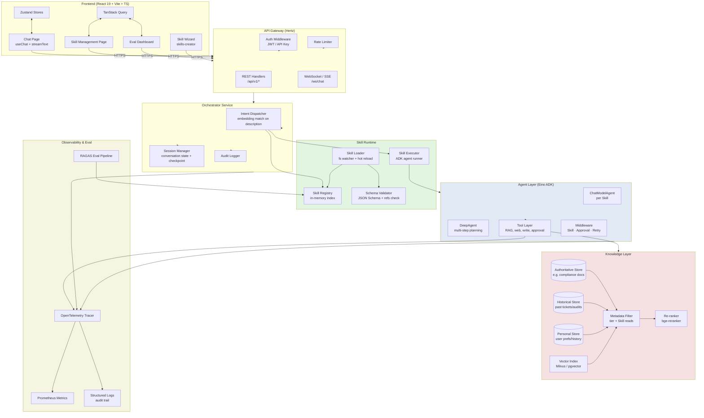

# Architecture: SkillForge

**Project:** SkillForge — Skill-driven Enterprise Agent Platform
**Researched:** 2026-08-10
**Stack:** Go (Eino + Eino ADK + Hertz) · React 19 + Vite + TS (Vercel AI SDK)
**Confidence:** HIGH on core architectural decisions; MEDIUM on Phase 1 implementation specifics (Eino ADK API surface still evolving per v0.8 notes)

---

## 1. Executive Summary

SkillForge is a **platform, not an application**. The platform surface is the Skill file format (`SKILL.md`); the runtime is a generic Agent kernel that adapts to whatever Skill is loaded. The architecture has six layers:

```
┌─────────────────────────────────────────────────────────────────┐
│  Frontend (React 19 + AI SDK streaming + Zustand + TanStack)    │
└─────────────────────────────────────────────────────────────────┘
                              │  HTTP REST + WebSocket / SSE
┌─────────────────────────────────────────────────────────────────┐
│  API Gateway (Hertz): auth, rate-limit, routing, CORS, /chat    │
└─────────────────────────────────────────────────────────────────┘
                              │
┌──────────────┬──────────────┴──────────────�───────────────────┐
│  Skill       │  Agent Orchestration        │  Knowledge &      │
│  Runtime     │  (Eino ADK + DeepAgent)     │  RAG Layer        │
│              │                             │                   │
│ • Loader     │ • Skill→ADK config mapper   │ • Tiered stores   │
│ • Registry   │ • Multi-agent composition   │ • Vector index    │
│ • Dispatcher │ • Session state mgmt        │ • Hybrid retriever│
│ • Executor   │ • Tool guardrails           │ • Citation track  │
└──────────────┴──────────────┬──────────────┴───────────────────┘
                              │
┌─────────────────────────────────────────────────────────────────┐
│  Observability & Eval: callback handlers · structured logging  │
│  RAGAS-style eval pipeline · audit trail · token/latency metrics│
└─────────────────────────────────────────────────────────────────┘
```

**Architectural pillars (decisions that constrain the rest):**

1. **Skill is the unit of customization.** Everything below the Skill schema is generic. Adding a new use case (compliance / customer support / sales playbook) = authoring a new `SKILL.md`, zero code.
2. **Eino ADK is the orchestration substrate.** Each Skill compiles to a `ChatModelAgent` (or `DeepAgent` for complex cases); multi-skill requests compose via `SequentialAgent` / `ParallelAgent` / `ConditionalAgent`.
3. **Knowledge has tiers, and Skill declares its tier access.** `reads` field in `SKILL.md` is enforced at the retriever layer (metadata filter), not just prompt-level. Writes go through a separate approval pipeline.
4. **Agentic RAG, not naive RAG.** The agent decides whether to retrieve, when to retrieve, whether retrieved evidence is sufficient, and whether to refuse. Refusal is a first-class outcome, not a fallback.
5. **Streaming-first API.** Chat experience is the primary surface; everything else (skill mgmt, eval) is secondary. WebSocket + SSE for streaming; REST for management.
6. **Observability is non-negotiable.** Callback handlers on every agent run; eval harness runs on every PR; structured logs feed a local dashboard.

---

## 2. Component Diagram



---

## 3. Layer-by-Layer Specification

### 3.1 Skill Schema (`SKILL.md`)

**File format:** YAML frontmatter + Markdown body. Lives at `<skills-dir>/<skill-name>/SKILL.md`.

#### 3.1.1 Six fields — exact spec

```yaml
---
# ─── 1. description ────────────────────────────────────────────────
# Used for semantic routing. Must describe WHEN this skill applies,
# not just WHAT it does. Embed by dispatcher for similarity match.
# Length: 50-500 chars. Include trigger phrases.
description: |
  Reviews enterprise compliance and policy documents against proposed
  actions or queries. Use when the user asks about regulatory compliance,
  internal policy review, SOP validation, or "is this allowed by our
  handbook." Does NOT handle general legal advice or external regulation.

# ─── 2. agent ──────────────────────────────────────────────────────
# Which ADK agent archetype to instantiate.
# - "chat":   ChatModelAgent, single ReAct loop
# - "deep":   DeepAgent with planning + todos + sub-agents
# - "router": ConditionalAgent that delegates to sub-skills
agent: chat

# ─── 3. reads ──────────────────────────────────────────────────────
# Knowledge tier whitelist. Enforced at retriever layer.
# Tiers: "authoritative" | "historical" | "personal"
# Optional path patterns to further scope.
reads:
  tiers: [authoritative]
  paths:
    - "compliance/**"
    - "handbook/**"
  max_top_k: 8
  require_citation: true   # refuses if no evidence retrieved

# ─── 4. writes ─────────────────────────────────────────────────────
# What this Skill is allowed to mutate. Empty list = read-only.
# Each write requires approval flow defined in guardrails.
writes: []   # compliance review is read-only by default

# ─── 5. steps ──────────────────────────────────────────────────────
# Optional: explicit step list. If empty, agent is ReAct-driven.
# Use when deterministic flow is needed (e.g. always: retrieve → verify → answer)
steps:
  - retrieve   # call knowledge retriever
  - verify     # cross-check retrieved docs
  - answer     # generate cited response
  - refuse     # if evidence insufficient

# ─── 6. guardrails ─────────────────────────────────────────────────
# Refusal policy + safety constraints.
guardrails:
  refusal_policy: "always"   # never hallucinate; refuse if uncertain
  max_context_docs: 10
  forbidden_outputs: ["specific_liability_advice", "external_regulation_quotes"]
  require_explicit_citations: true
  confidence_threshold: 0.7
  approval_required_for: []   # nothing (read-only skill)
---
```

#### 3.1.2 Validation rules

| Field | Required | Validation |
|-------|----------|------------|
| `description` | yes | non-empty, 50-500 chars, must contain at least one trigger phrase |
| `agent` | yes | enum: `chat`, `deep`, `router` |
| `reads` | yes | tiers ∈ {authoritative, historical, personal}, paths are glob patterns |
| `writes` | yes | can be `[]`, but if non-empty each write must declare target tier + approval |
| `steps` | no | if provided, must be from a known vocabulary |
| `guardrails` | yes | refusal_policy ∈ {`always`, `on_low_confidence`, `never`} |

**Validation is enforced at load time** by a JSON Schema in the registry. Invalid Skills fail to load; the registry logs the error and skips. The frontend surfaces validation errors in the Skill Management page.

#### 3.1.3 How `reads`/`writes` enforce knowledge boundary

- **`reads.tiers`** → at runtime, the knowledge retriever applies a metadata filter `tier IN [tiers]` before vector search. The Skill physically cannot see documents outside its declared tiers.
- **`reads.paths`** → second metadata filter on document path glob.
- **`reads.require_citation`** → the executor refuses to call the LLM if retrieval returned zero docs above the score threshold.
- **`writes`** → each write op is wrapped in an approval middleware that calls back to the user. Writes that violate tier scope (e.g. writing personal data to authoritative store) are rejected at middleware level.

**Why this matters:** denova encodes "what to read" implicitly inside the agent's body steps. We make it **structural**. The Skill Wizard can lint these declarations; the eval pipeline can test boundary violations; the audit trail can prove the Skill never accessed unauthorized data.

---

### 3.2 Skill Runtime

Four sub-components: **Loader**, **Registry**, **Dispatcher**, **Executor**.

#### 3.2.1 Loader

```
┌────────────────────────────────────────────────────────┐
│  Loader                                                │
│                                                        │
│  1. Watch <skills-dir>/**/SKILL.md via fsnotify        │
│  2. On change → parse YAML + Markdown body             │
│  3. Validate against JSON Schema                       │
│  4. Hot-reload: replace Registry entry atomically      │
│  5. Compute description embedding (cache to disk)      │
│  6. Emit load event to registry subscribers            │
└────────────────────────────────────────────────────────┘
```

**Hot-reload semantics:** when a Skill changes, in-flight agent runs using the old version continue; new requests use the new version. Checkpoint IDs are namespaced by Skill version to avoid state mixing.

#### 3.2.2 Registry

In-memory index keyed by Skill name. Stores:
- Parsed `SKILL.md` struct
- Description embedding (vector) for dispatcher matching
- ADK agent config (compiled)
- Version + timestamp
- Stats: invocation count, refusal count, avg latency

```go
type SkillEntry struct {
    Skill          *SkillManifest
    DescriptionVec []float64
    Agent          adk.Agent        // pre-built per Skill
    Version        string
    LoadedAt       time.Time
    Stats          SkillStats
}
```

#### 3.2.3 Dispatcher (intent → Skill)

Three-step pipeline:

1. **Embedding match:** embed user query with same model used for Skill descriptions. Cosine similarity against all Skill description vectors. Take top-K (typically 3).
2. **Tie-break / filter:** drop Skills whose `guardrails.refusal_policy` is incompatible with intent (rare). If top match score < threshold (e.g. 0.5), fall back to `default` Skill.
3. **Compose (if multi-skill):** if user query spans multiple skills (e.g. "compare our compliance doc to last quarter's audit"), use ADK `SequentialAgent` or `ParallelAgent` to compose.

**Dispatcher is itself an agent** (a `ChatModelAgent` whose job is to select Skills). Its output is the chosen Skill entry + a routing reason that's logged for audit.

#### 3.2.4 Executor

```go
// Pseudocode
func (e *Executor) Execute(ctx, skillName, sessionID, messages) {
    entry := registry.Get(skillName)
    runner := adk.NewRunner(ctx, adk.RunnerConfig{
        Agent:           entry.Agent,
        EnableStreaming: true,
        CheckPointStore: sessionStore,  // for HITL/interrupt
    })
    return runner.Run(ctx, messages, adk.WithSessionValues(...))
}
```

The Executor wraps Runner with:
- **Approval middleware** (if Skill has writes) — see §3.7
- **Citation tracker** — collects document refs from retriever tool calls
- **Refusal gate** — post-process: if Skill has `require_citation=true` and no citations found, force refusal output

---

### 3.3 Agent Orchestration Layer (Eino ADK Mapping)

#### 3.3.1 Mapping Skill → ADK Agent

| Skill `agent` field | ADK type | When |
|---|---|---|
| `chat` | `ChatModelAgent` | Single ReAct loop, one Skill per request |
| `deep` | `DeepAgent` | Multi-step planning, todo list, filesystem backend |
| `router` | `ConditionalAgent` | Delegates to sub-Skills based on intent |

**For the demo Skill (compliance review):** `agent: chat` is sufficient. The ReAct loop is: user query → retrieve from authoritative tier → verify retrieval → answer with citations OR refuse.

#### 3.3.2 Multi-agent composition

For complex requests spanning multiple Skills, use `SequentialAgent` (output of one feeds next) or `ParallelAgent` (independent results merged).

Example: "Review this contract against our compliance handbook AND last year's similar contracts."
- Skill A: compliance review (reads: authoritative/compliance)
- Skill B: precedent search (reads: historical/contracts)
- Compose via `ParallelAgent`, then a final synthesis `ChatModelAgent`

#### 3.3.3 State management across turns

- **Session state** lives in `CheckPointStore` (per ADK pattern). Skill runs can be interrupted (HITL for write approval) and resumed.
- **Conversation memory** is scoped to Skill version. When Skill is reloaded, old conversation can still resume against the version that produced it.
- **Cross-session persistence:** the personal knowledge tier is the only state that crosses sessions. Writes to personal tier are explicit (user opt-in via Skill Wizard or chat command).

---

### 3.4 Knowledge Layer (True-Source Separation)

#### 3.4.1 Tier schema

```go
type Document struct {
    ID       string
    Content  string
    Meta     map[string]any
    Tier     Tier         // authoritative | historical | personal
    Path     string       // e.g. "compliance/handbook/2024/data-privacy.md"
    Source   string       // origin system
    AddedAt  time.Time
    AddedBy  string       // who/what ingested this
    Expires  *time.Time   // null = no expiry
    Checksum string       // integrity verification
}
```

| Tier | Mutability | Examples | Authority |
|---|---|---|---|
| `authoritative` | Append-only, requires admin | Compliance docs, handbooks, regulations | Absolute — overrides other tiers |
| `historical` | Append-only | Past tickets, audits, archived decisions | High — provides context but yields to authoritative |
| `personal` | User-owned, edit/delete | User preferences, past queries, private notes | User-revisable |

#### 3.4.2 Storage layout

**Vector DB:** Milvus or pgvector. One collection per tier (or one collection with `tier` filter — Milvus supports `expr` filtering on scalar fields).

**Metadata DB:** Postgres or SQLite for v1. Stores doc metadata, checksums, ingest history.

**Why separate vector collections vs single:** separate collections enforce tier isolation at the index level (the retriever literally cannot query the wrong tier). Single collection with filter is simpler operationally but relies on filter discipline.

**v1 recommendation:** single collection + metadata filter (`tier IN [...]`). Simpler to operate. The `reads.tiers` filter is applied at retriever call site; if a bug bypasses the filter, the audit log can detect it.

#### 3.4.3 Per-Skill reads enforcement

Two layers of enforcement:

1. **Application layer:** Dispatcher passes Skill's `reads.tiers` to retriever options. Default-denied: if a Skill has no `reads`, it sees nothing.
2. **Audit layer:** every retriever call is logged with `skill_name`, `requested_tiers`, `actual_tiers_searched`. Post-hoc audit script verifies no Skill violated its declared scope.

---

### 3.5 RAG Layer (Agentic RAG)

#### 3.5.1 Retrieval strategies

| Strategy | When | Implementation |
|---|---|---|
| **Dense vector** (default) | Semantic similarity | Embedding model + cosine similarity |
| **BM25 / keyword** | Exact term lookup (regulation IDs, clause numbers) | Elasticsearch / OpenSearch / Tantivy |
| **Hybrid** (vector + BM25) | Best of both; default for compliance | Reciprocal rank fusion or weighted combination |
| **Re-ranked** | Improve precision on top-K | bge-reranker / Cohere Rerank |

For the compliance demo Skill: hybrid (BM25 for clause numbers, vector for semantic), re-ranked.

#### 3.5.2 Agent decision loop

The Skill's retriever is exposed as a **tool** to the agent. The agent decides:

```
User Query
    ↓
[Agent: decide action]
    ├─→ retrieve(query, tier_filter) → docs
    │       ↓ (if docs found)
    ├─→ verify_sufficiency(docs, query) → bool + confidence
    │       ↓ (if confidence > threshold)
    ├─→ answer_with_citations(docs, query)
    │       ↓ (if confidence < threshold)
    └─→ refuse("insufficient_evidence")
```

This loop is enforced by `steps` field in `SKILL.md`. If `steps: [retrieve, verify, answer, refuse]`, the agent's ReAct loop is constrained to these actions (or its prompt is biased toward them).

#### 3.5.3 Citation tracking

Every retrieved document carries:
- `doc_id`
- `path` (e.g. clause 4.2.1)
- `tier`
- `score`
- `retrieval_step` (which retrieve call produced it)

The citation tracker middleware collects these and attaches to the final response as a structured `citations` array. The frontend renders these as clickable references; clicking shows the source passage.

#### 3.5.4 Eval hooks

Every Skill execution emits an eval event:
```json
{
  "skill": "compliance-review",
  "session": "...",
  "retrieved_docs": [...],
  "cited_docs": [...],
  "refused": false,
  "confidence": 0.85,
  "latency_ms": 1234,
  "tokens": {"prompt": 800, "completion": 200}
}
```

The RAGAS eval pipeline (running periodically or on PR) computes:
- Faithfulness (does answer match cited evidence?)
- Answer relevancy
- Context precision/recall
- **Refusal accuracy** (correctly refused when evidence was insufficient)
- **Citation accuracy** (cited passages actually support claims)

---

### 3.6 Guardrails & Observability

#### 3.6.1 Refusal policy

Three modes (per Skill):
- `always`: refuse if confidence < threshold (strict — demo Skill uses this)
- `on_low_confidence`: refuse only when retrieval returns nothing or score < threshold
- `never`: answer with best-effort (only safe for non-critical Skills)

Implementation: refusal is a **tool the agent can call**. The system prompt explicitly instructs: "If evidence is insufficient, call `refuse(reason)`. Do not fabricate."

#### 3.6.2 Eval pipeline

Standalone CLI (run in CI or manually):

```
skillforge eval --skill compliance-review --dataset eval/compliance.jsonl
```

Outputs metrics to console + writes to `eval/runs/<timestamp>/report.json`. Frontend Eval Dashboard visualizes historical runs.

**v1 dataset:** hand-curated 50-100 Q&A pairs covering common compliance questions + adversarial cases (questions with no answer in authoritative docs to test refusal).

#### 3.6.3 Logging & tracing

- **OpenTelemetry** traces per agent run via callback handlers (Eino provides `callbacks.NewHandlerBuilder`)
- **Structured logs** (slog): every retriever call, every refusal, every approval decision
- **Metrics** (Prometheus): `agent_requests_total`, `agent_latency_seconds`, `agent_refusal_total`, `agent_tokens_total`
- **Audit trail:** append-only log of Skill invocations with input query, retrieved doc IDs, output, and citations. Required for the "open source / enterprise trustable" positioning.

---

### 3.7 API Surface (Hertz REST + WebSocket/SSE)

#### 3.7.1 Endpoints

| Method | Path | Purpose |
|---|---|---|
| `POST` | `/api/v1/chat/stream` | SSE streaming chat (primary surface) |
| `WS` | `/ws/chat` | WebSocket bidirectional chat (for multi-turn with tool calls) |
| `GET` | `/api/v1/skills` | List available Skills |
| `GET` | `/api/v1/skills/:name` | Skill detail (manifest + stats) |
| `POST` | `/api/v1/skills` | Create/update Skill (writes file, triggers reload) |
| `DELETE` | `/api/v1/skills/:name` | Remove Skill |
| `POST` | `/api/v1/skills/wizard` | Skill Wizard (natural language → SKILL.md) |
| `GET` | `/api/v1/knowledge/tiers/:tier/docs` | List docs in a tier (admin) |
| `POST` | `/api/v1/knowledge/ingest` | Ingest document into tier |
| `GET` | `/api/v1/eval/runs` | Eval run history |
| `POST` | `/api/v1/eval/run` | Trigger eval |
| `GET` | `/api/v1/health` | Health check |

#### 3.7.2 Auth

v1: simple API key in header for admin endpoints; chat endpoint is open or single-tenant token (no multi-tenant SaaS in v1 per PROJECT.md).

#### 3.7.3 Rate limiting

Hertz middleware: token bucket per IP for `/chat/*`; per-API-key for admin endpoints.

#### 3.7.4 Streaming protocol

Two implementations to support different client needs:
- **SSE (`/chat/stream`):** simpler, works with native `EventSource` and Vercel AI SDK's `streamText` SSE consumption. Use for one-shot question → answer.
- **WebSocket (`/ws/chat`):** bidirectional, needed for tool calls where frontend shows intermediate "retrieving..." states and awaits user approval on writes.

**Recommendation:** implement WebSocket first; Vercel AI SDK supports both but WebSocket gives better UX for Agentic RAG flows where the user sees retrieval happen in real time.

---

### 3.8 Frontend Architecture

#### 3.8.1 Page structure

```
/                     → redirects to /chat
/chat                 → Chat interface (primary)
/chat/:sessionId      → Resume previous chat
/skills               → Skill management (list, search, browse)
/skills/:name         → Skill detail (manifest viewer, stats)
/skills/new           → Skill Wizard (skills-creator)
/knowledge            → Knowledge admin (browse tiers, ingest)
/eval                 → Eval dashboard (run history, metrics)
/settings             → API keys, model config
```

#### 3.8.2 State management

- **Zustand** for UI state: current Skill, chat session ID, streaming status, modal state. Lightweight, no Provider hell.
- **TanStack Query** for server state: Skills list, eval runs, knowledge docs. Caching, refetching, optimistic updates.
- **Local component state** for form inputs.

#### 3.8.3 AI SDK integration

Vercel AI SDK provides:
- `useChat()` hook — manages messages, tool calls, streaming
- `streamText()` (server) / `useChat` consumption — handles SSE/WebSocket → React state
- `tool()` definitions — register tool schemas for client tool calls (e.g. UI-side approval buttons)

**Pattern for Skill execution streaming:**

```tsx
// Frontend
const { messages, sendMessage, addToolOutput } = useChat({
  transport: new DefaultChatTransport({
    api: '/ws/chat',  // WebSocket for bidirectional
  }),
  onToolCall: async ({ toolCall }) => {
    if (toolCall.toolName === 'request_approval') {
      // Show approval modal, then:
      addToolOutput({ tool: 'request_approval', toolCallId: toolCall.toolCallId, output: { approved: true } });
    }
  },
});
```

The backend translates Eino's `AgentEvent` stream → AI SDK stream parts (`text`, `tool-call`, `tool-result`). Mapped via custom transport or a thin adapter layer.

---

## 4. Build Order — Dependency-Ordered Milestones

### Phase 1: Skill Runtime + Single Demo Skill (MVP slice)

**Goal:** Load one Skill, route one query, retrieve from one tier, return cited answer.

**Build:**
1. Hertz server skeleton + `/api/v1/skills` CRUD
2. Skill Loader (fswatcher) + Registry + JSON Schema validator
3. Single hard-coded dispatcher (no embedding yet — name match)
4. Eino ADK ChatModelAgent bound to demo Skill
5. Retriever tool (single tier: authoritative, BM25 + vector hybrid)
6. Basic `/chat` endpoint → non-streaming JSON response
7. Citation tracking in response

**Dependencies:** nothing
**Deliverable:** end-to-end "ask a compliance question → get cited answer or refusal" via curl

---

### Phase 2: Streaming + Frontend Chat

**Goal:** Real chat UX.

**Build:**
1. WebSocket transport for `/ws/chat`
2. Eino Runner with `EnableStreaming: true`
3. AgentEvent → SSE/WebSocket frame adapter
4. React chat page with `useChat()`
5. Citation rendering (clickable refs)
6. Refusal UI (red banner when Skill refuses)

**Depends on:** Phase 1
**Deliverable:** usable chat at `localhost:5173/chat`

---

### Phase 3: Skill Wizard + Multi-Skill Routing

**Goal:** Make Skills first-class (user can create them) and route between them.

**Build:**
1. Embedding-based dispatcher (replace name match)
2. Skill Wizard UI + backend (`/skills/wizard`)
3. Skill Wizard agent: natural language → `SKILL.md` (uses Eino ChatModelAgent with structured output)
4. Skill validation in UI (show JSON Schema errors)
5. Multi-skill composition (`SequentialAgent` / `ParallelAgent`)

**Depends on:** Phase 2
**Deliverable:** user can describe a new use case → get a working Skill

---

### Phase 4: Knowledge Layer Full

**Goal:** True three-tier knowledge with enforced boundaries.

**Build:**
1. Knowledge admin page (`/knowledge`)
2. Document ingestion pipeline (file → chunk → embed → store)
3. Three tier stores with metadata filter at retriever
4. `reads.tiers` enforcement at retriever call site
5. Audit log of retriever calls per Skill

**Depends on:** Phase 3
**Deliverable:** Skill can only see docs in its declared tiers; audit proves it

---

### Phase 5: Eval + Observability

**Goal:** Measurable quality. The "open source / brandable" moat.

**Build:**
1. RAGAS eval pipeline as CLI + scheduled job
2. Eval dataset for compliance Skill (50-100 Q&A)
3. Eval dashboard (`/eval`) — run history, metrics trends
4. OpenTelemetry tracing + Prometheus metrics
5. Structured audit log viewer (`/audit` or `/settings`)
6. Per-Skill stats (latency, refusal rate, token cost)

**Depends on:** Phase 4 (need real Skills to eval)
**Deliverable:** every PR shows eval deltas; dashboard proves Skill quality

---

### Phase 6: Polish & Open Source

**Goal:** Demo-ready for personal brand.

**Build:**
1. Docker Compose (Go backend + Postgres + Milvus + frontend dev server)
2. README, docs site, architecture diagram (this document)
3. Sample `SKILL.md` files (compliance, customer support, sales playbook)
4. CI: lint + test + eval on PR
5. Demo video + screenshots

**Depends on:** Phase 5
**Deliverable:** clone → docker compose up → working SkillForge

---

### Deferred (Out of Scope per PROJECT.md)

- Multi-tenant SaaS, billing, user mgmt
- Desktop binary
- K8s/Helm, enterprise SSO
- Real-time collaborative Skill editing
- LLM fine-tuning
- Mobile native

---

## 5. Data Flow Examples

### 5.1 Simple compliance query

```
[User] "Is X allowed by our data privacy handbook?"
  ↓ POST /ws/chat
[Hertz] → [Auth] → [Session load]
  ↓
[Orchestrator] → [Dispatcher.embed("Is X allowed...")] 
  ↓ cosine match → compliance-review (score 0.92)
[Executor] → [ChatModelAgent with reads=[authoritative/compliance]]
  ↓ ReAct loop
[Agent] → retrieve_tool("data privacy X", tier=authoritative, path=compliance/**)
  ↓
[Retriever] → filter: tier=authoritative AND path LIKE 'compliance/%'
  ↓ BM25 + vector hybrid → top 5 docs
[Agent] → verify_sufficiency(docs) → confidence 0.88 > 0.7 threshold
  ↓
[Agent] → answer with [doc1, doc3, doc5] citations
  ↓ stream AgentEvent → AI SDK stream parts
[WebSocket] → [useChat]
[UI] renders answer + clickable citations
  ↓ on click → drawer shows doc snippet
  ↓
[Audit log] {skill: compliance-review, retrieved: [d1,d3,d5], cited: [d1,d3,d5], refused: false, latency: 1234ms, tokens: 950}
```

### 5.2 Refusal flow

```
[User] "What does GDPR Article 17 say about our internal deletion policy?"
  ↓
[Dispatcher] → compliance-review (score 0.81)
[Executor] → [ChatModelAgent with reads=[authoritative/compliance]]
  ↓
[Agent] → retrieve_tool("GDPR Article 17 internal deletion")
  ↓ Retriever filter: tier=authoritative AND path=compliance/**
  ↓ Result: 0 docs above threshold (GDPR is external regulation, not in handbook)
[Agent] → guardrail triggers: forbidden_outputs includes "external_regulation_quotes"
[Agent] → refuse(reason="query references external regulation not in authoritative scope")
  ↓
[UI] renders refusal banner + reason
[Audit log] {skill: compliance-review, retrieved: 0, refused: true, reason: "..."}
```

### 5.3 Skill hot-reload

```
[Developer] edits /skills/sales-playbook/SKILL.md
  ↓ fsnotify event
[Loader] → parse + validate → replace Registry["sales-playbook"]
  ↓ re-embed description
  ↓ emit SkillUpdated event
[Audit log] {event: skill_updated, name: sales-playbook, version: "v2", by: developer}
  ↓
[Next request for sales-playbook] uses new version
[In-flight requests] continue with v1 (their CheckPointID is namespaced)
```

---

## 6. Key Architectural Decisions (Recap)

| Decision | Rationale | Affects |
|---|---|---|
| `SKILL.md` 6 fields with explicit `reads`/`writes` | denova's implicit reads/writes becomes auditable + wizard-generatable | Skill schema, runtime, wizard |
| Eino ADK `ChatModelAgent` as primary archetype | ReAct loop matches single-skill use case; DeepAgent when needed | Orchestration |
| Skill description embedding for routing | User natural language → right Skill without manual config | Dispatcher |
| Knowledge tiers enforced at retriever | Skill physically cannot violate scope (not just prompt discipline) | Knowledge, security |
| Agentic RAG (agent decides retrieve/refuse) | Naive RAG hallucinates; refusal is feature | RAG layer, eval |
| WebSocket + SSE dual protocol | SSE for simple streams; WebSocket for tool calls + approval UI | API surface |
| Zustand + TanStack Query split | Standard React 19 pattern; no Provider hell; SSR-friendly if needed later | Frontend |
| Phased build with demo Skill in Phase 1 | Forces vertical slice before horizontal breadth | Roadmap |

---

## 7. Open Questions / Research Flags for Phase Implementation

- **Eino ADK API stability:** v0.8 notes mention ongoing middleware changes. Phase 1 may need to pin a specific Eino version and re-validate. **Flag Phase 1 for Eino version research.**
- **Vector DB choice:** Milvus vs pgvector for v1. pgvector is simpler (one Postgres instance) but Milvus scales better. **Defer to Phase 4 — start with pgvector for dev, document Milvus migration path.**
- **Citation format:** AI SDK's `tool-call` stream parts are generic; need to define a SkillForge-specific format for citations. **Decide in Phase 2.**
- **HITL approval UI:** when Skill has writes, how does approval modal integrate with `useChat`'s `onToolCall`? **Phase 3.**
- **Eval dataset sourcing:** 50-100 compliance Q&A is hand-curated or synthetic? Recommend hybrid: 30 hand-curated for ground truth, 70 synthetic with LLM-as-judge validation. **Phase 5.**

---

## 8. Sources

- CloudWeGo Eino official docs: <https://www.cloudwego.io/docs/eino/>
  - ChatModelAgent: <https://www.cloudwego.io/docs/eino/overview/eino_adk_quickstart>
  - Skill Middleware: <https://www.cloudwego.io/docs/eino/core_modules/eino_adk/eino_adk_chatmodelagentmiddleware/middleware_skill>
  - DeepAgent: <https://www.cloudwego.io/docs/eino/core_modules/eino_adk/agent_implementation/deepagents>
  - Callback & Trace: <https://www.cloudwego.io/docs/eino/quick_start/chapter_06_callback_and_trace>
  - Retriever: <https://www.cloudwego.io/docs/eino/core_modules/components/retriever_guide>
  - ADK v0.8 Migration: <https://www.cloudwego.io/docs/eino/release_notes_and_migration/eino_v0.8._-adk_middlewares>
- CloudWeGo Hertz docs: <https://www.cloudwego.io/docs/hertz/>
  - SSE: <https://www.cloudwego.io/docs/hertz/tutorials/basic-feature/sse>
  - WebSocket: <https://www.cloudwego.io/docs/hertz/tutorials/third-party/protocol/websocket>
- Vercel AI SDK docs: <https://ai-sdk.dev/>
  - Stream Text: <https://github.com/vercel/ai/blob/main/content/docs/07-reference/01-ai-sdk-core/02-stream-text.mdx>
  - Tool usage: <https://github.com/vercel/ai/blob/main/content/docs/04-ai-sdk-ui/03-chatbot-tool-usage.mdx>
  - useChat with tool calls: <https://github.com/vercel/ai/blob/main/content/docs/09-troubleshooting/05-tool-invocation-missing-result.mdx>
- Eino Examples (Skill chapter): <https://github.com/cloudwego/eino-examples/blob/main/quickstart/chatwitheino/docs/ch09_skill.md>
- denova (alfredxw/denova) — referenced in PROJECT.md; skills/subagents + true-source separation

---

*Last updated: 2026-08-10*
