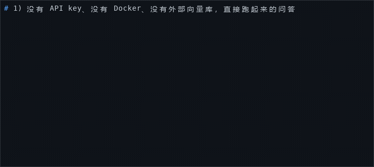

# SkillForge

> ### SkillForge —— 可验证的企业 agent 运行时
> ### 要闸门，不要分数。
> 社区给你一个 score；SkillForge 给你一个 gate。

**决定一个 agent 能不能进生产的问题，不是"它能不能答"，而是"这个答案能不能被证明"。**
Most agent tooling answers the first question and hands you a number.
SkillForge is built around the second one.

| 层 | 命题 | 落地位置 |
|---|---|---|
| **可证明的证据** | 每条引用 span 都逐字校验过它指向的 chunk；只有 `authority` 角色的 chunk 能背书引用；信任条款由代码注入，Skill 正文在结构上无法覆盖它。 | `internal/verdict/grounding.go` · `internal/kb.CitableRole` · `internal/platformfloor` |
| **可证明的执行** | 写操作必须经人批，且人批的字节 = 执行的字节；一切执行可审计，可导出为 W3C PROV-O。 | `internal/agent/hitl` · `internal/auditprov` |
| **可证明的演进** | Skill 变更必须过冻结评测门禁才能晋级；领域本体由人提议、人审批、版本化、可回滚。 | `.github/workflows/eval-gate.yml` · `internal/ontology` |

**现在就能验证的东西** — 每一条都可以在本仓库里点开验证，不需要相信任何宣传语:

- **引用 span 不逐字出现在 chunk 里，整条裁决就降级。**
  `internal/verdict/grounding.go` — span 与 chunk 正文逐字比对，失配则置信度封顶并翻转为"需复核"。
- **只有 `authority` 角色的知识库能背书引用。**
  白名单是一个代码常量（`internal/kb.CitableRole`），不是一句 prompt 里的叮嘱。
- **人批的字节就是执行的字节。**
  `frozen_args` 是对工具调用参数的 SHA-256；审批记录存哈希，执行端重新推导，漂移即 fail-closed。
- **审计台账是 INSERT-only。**
  撤销一条规则 = `DELETE` + 一条新的 `action_rule_revoked` 行，历史从不被改写。
- **整条审计链可导出为 W3C PROV-O**
  （`GET /api/session/:id/audit/prov`）。
- **退化的 Skill 发不出去。**
  `eval-gate.yml` 重放冻结评测集，失败即 fail-closed。

**What is a Skill here?** A `SKILL.md` file in SkillForge is a *domain
adaptation contract* (knowledge tier boundaries + write targets +
refusal guardrails + system prompt). It is **not** a sandboxed skill
plugin (the WeKnora usage) and not an MCP tool (the Anthropic Agent
Skills usage). One `SKILL.md` retargets the same agent kernel to
legal review, HR policy, IT helpdesk, or any other business domain
— no recompilation, no code changes. Seven Skill templates ship in
[`examples/skills/`](examples/skills/) — `simple-qa`, `calculator`,
`compliance`, `compliance-orchestrator`, `external-lookup`,
`kpi-dashboard`, and `monthly-report` — of which `calculator` is
**validate-only**: the runtime is a RAG pipeline today and does not yet
execute pure-tool Skills (D7-10). [`CONTRIBUTING.md`](CONTRIBUTING.md)
walks you through writing your own.



[](https://go.dev/)
[](LICENSE)
[](https://github.com/NDCCCCCC/skillforge/actions/workflows/ci.yml)
📄 [Architecture](docs/architecture.md) · [Security policy](SECURITY.md) · [Code of Conduct](CODE_OF_CONDUCT.md) · [Contributing](CONTRIBUTING.md)

---

## Why a gate, not a score

**`SKILL.md` is now an open standard, so "we ship a `SKILL.md` format" is no longer a differentiator.** Anthropic published the format in 2025-12 at `agentskills.io` and donated it to the Agentic AI Foundation on 2026-10-22, where it is being standardized across Anthropic, OpenAI, Cursor, Microsoft, Vercel and Lovable. A `SKILL.md` loader is table stakes.

**The scoring and gating tools exist too — separately, and each is good at its own job.** Ragas / DeepEval / TruLens give you a **score**. LangGraph's `interrupt` gives you a **mid-flow suspension**. TopBraid's SHACL gives you a **violation report**. Casbin / OPA give you a **policy decision**. None of these is a toy.

**What SkillForge ships is the combination** — six mechanisms wired into one auditable execution contract:

1. A citation span is checked **verbatim** against the chunk it points at; a mismatch downgrades the whole verdict.
2. Only an `authority`-role chunk may **back a citation** — the allowlist is a code constant.
3. The trust clauses are **injected at code level**, so a Skill body cannot overwrite them.
4. Approval binds to the **`frozen_args` bytes**, so approved arguments and executed arguments cannot drift.
5. The execution ledger is **INSERT-only** and exports as **W3C PROV-O**.
6. A Skill promotion **fails closed** on a frozen replay.

We are **not** claiming this combination is unique in the industry — several projects
solve parts of it, and the ecosystem is moving fast in exactly this direction. What
we claim is that here it is **one contract, one auditable artifact, end to end** —
and that every link of it is verifiable in this repository rather than in a
marketing deck.

---

## Quick Start

Get a document-grounded, cited answer running in your browser.

> **The first run is not instant.** `ollama pull bge-m3` downloads ~1.2 GB of
> weights, and the startup indexer embeds the corpus before the server serves
> its first request — that is minutes, not seconds, on a cold machine. After
> the first run the model is already pulled. No API key is needed to get that
> far: with neither `LOCAL_API_KEY` nor `GLM_API_KEY` set, the server boots in
> **stub LLM mode** (see [below](#no-api-key-stub-llm-mode)).

### Prerequisites

| Dependency | Why | Minimum |
|------------|-----|---------|
| **Docker** (with Compose v2) | Runs the full stack (Milvus + backend + frontend) | Docker Desktop or Docker Engine |
| **Ollama** (or any OpenAI-compatible embedding endpoint) | Serves the BGE-M3 embedding model | `ollama pull bge-m3` |
| **GLM API key** (Zhipu Coding Plan) | Powers the LLM + the trust evaluator judge | [open.bigmodel.cn](https://open.bigmodel.cn/) — optional, see stub mode |
| **~8 GB RAM** | Milvus standalone + Go backend + nginx | Milvus alone uses ~4 GB |

### Steps

```bash
# 1. Clone
git clone https://github.com/NDCCCCCC/skillforge.git
cd skillforge

# 2. Configure environment
cp .env.example .env
# Edit .env and fill in:
#   GLM_API_KEY=<your Zhipu key>
#   BGE_M3_URL=http://localhost:11434/v1/embeddings   (default; ollama)
#   SKILLFORGE_MCP_SERVICE_SKILL=simple-qa            ← REQUIRED
#     The server refuses to boot without it ("D-TRUST-02: no admin
#     baseline bypass"). It names the Skill whose read-access tiers
#     the MCP / knowledge-graph surfaces resolve against.

# 3. Start the embedding endpoint (local minimum)
ollama pull bge-m3

# 4. Pick the live Skill. The repo ships several Skills under skills/
#    (simple-qa, compliance, compliance-orchestrator, calculator,
#    external-lookup, kpi-dashboard, monthly-report, sql-guides); the one
#    named by SKILLFORGE_MCP_SERVICE_SKILL is the one the graph / MCP
#    surfaces resolve against, and the chat UI lets you pick any of them
#    per session. To make the cited-verdict compliance demo the default:
#      cp -r examples/skills/compliance skills/ && rm -r skills/simple-qa
#    Restart for the change to take effect — see "What is not on the
#    production path yet" below for what hot-reload does and does not
#    do today.

# 5. Bring up the full stack (Milvus + backend + frontend)
docker compose up

# 6. Open the app
#    Browser: http://localhost:8080
```

> **Known gap in the Docker path:** `docker-compose.yml` does not yet forward
> `SKILLFORGE_MCP_SERVICE_SKILL` into the `backend` container, so the backend
> container refuses to start until that is wired. Until it is, either add
> `SKILLFORGE_MCP_SERVICE_SKILL: ${SKILLFORGE_MCP_SERVICE_SKILL:-simple-qa}`
> to the `backend` service's `environment:` block, or run the backend directly
> — see [Run without Docker / without an API key](#run-without-docker--without-an-api-key).

### Try it

Open **http://localhost:8080**, pick the **simple-qa** Skill, and ask a question about the loaded documents, e.g.:

> 差旅住宿费的报销标准是什么？

You should see either a **cited answer** (with clickable chunk references) or a **structured refusal** (e.g. `no_relevant_source`) — never a fabricated answer.

That is the platform in action: one kernel, one Markdown Skill file. Swap in a different template — the `compliance` Skill from `examples/skills/` — and the same kernel runs a different behavior, with a different knowledge boundary and a different set of guardrails. (`calculator` is a schema template only: it validates against the 7-field contract, but the runtime does not yet execute pure-tool Skills — D7-10.)

The backend is also directly reachable at `http://localhost:8888` for `curl` probes, and Milvus gRPC is at `localhost:19530`.

### No API key? Stub LLM mode

SkillForge boots **without any LLM API key**. When neither `LOCAL_API_KEY` nor `GLM_API_KEY` is set, the server starts in **stub LLM mode**: the pipeline's answer model is replaced by a deterministic extractor (`internal/server/stubchat`) that assembles each answer from the verbatim text of the top retrieved chunk — no LLM is called, and the retrieval / grounding / refusal machinery is the real production code.

Three annotations make a stub answer impossible to mistake for a real one (D-08):

1. **`[WARN]` at boot** — the server logs `STUB LLM MODE — no LOCAL_API_KEY / GLM_API_KEY configured` at startup, before any request is served.
2. **`mode: "stub"` on the wire** — every stub verdict carries `mode: "stub"` in its JSON payload; real-model answers never emit the field, so the wire format stays backward-compatible. The UI renders a `STUB` badge on such cards.
3. **Conservative verdicts** — stub answers are always capped at `confidence ≤ 0.5` with `review_required: true`.

Observable consequences: answers are always verbatim quotes from a cited chunk (never paraphrased), refusals are more frequent (the stub refuses instead of guessing when no usable chunk text is found), and every response shows the `STUB` badge plus the 人工复核 flag. Note that `BGE_M3_URL` (the embedding endpoint) is still **required** in stub mode — stubbed is the LLM, not the retriever. Setting `GLM_API_KEY` (or `LOCAL_API_KEY` for an OpenAI-compatible local endpoint) and restarting switches back to the real model.

## Releases

**Current development version: v1.7 — not tagged yet.** The latest tagged
release is **v1.6**; the v1.7 phases (47–51) are complete in the roadmap but
the tag has not been cut, so there is no v1.7 release artifact to download.
When the tag lands, the [Releases page](../../releases) ships prebuilt
binaries — `skillforge-server-linux-amd64` and `skillforge-server-windows-amd64`
(CGO builds — go-duckdb needs a C toolchain) together with structured release
notes. The linux binary is smoke-tested in stub mode by the release workflow;
see [release.yml](.github/workflows/release.yml).

Prefer building yourself? The [Quick Start](#quick-start) above is the
authoritative path and needs no release artifacts.

## Run without Docker / without an API key

The full stack above is the recommended path. This section is the **hermetic** path: no Docker, no Milvus, no etcd, no minio, and no LLM API key — just a Go toolchain, Node, and one embedding endpoint.

> **What `embedded` means.** `RETRIEVER_BACKEND=embedded` keeps the **vector store inside the backend process** (an in-process Go slice with cosine ranking). It does **not** mean the embedding model runs in-process: vectorization is always delegated to an external embedding endpoint, and there is **no fallback** — if that endpoint is unreachable the backend fails loudly instead of silently degrading to meaningless vectors.

### Prerequisites

| Dependency | Why | Minimum |
|------------|-----|---------|
| **Go** | Runs the backend | **1.25.5+** (the version `go.mod` declares; CI installs it from `go.mod`) — CGO toolchain required, see `make check-cgo` |
| **Node.js** | Runs the frontend dev server | **22+** (npm) — the version CI and `Dockerfile.frontend` both use |
| **One embedding endpoint** | Serves the embedding model — still required | see below |

### The embedding endpoint (still required — two interchangeable forms)

| Form | How | `BGE_M3_URL` |
|------|-----|--------------|
| **Local Ollama** (primary) | `ollama pull bge-m3` | `http://localhost:11434/v1/embeddings` |
| **Any OpenAI-compatible `/v1/embeddings` endpoint** | e.g. a hosted or self-hosted service | point `BGE_M3_URL` at its `/v1/embeddings` URL |

Both forms speak the same OpenAI-compatible wire format, so switching between them is a one-line `BGE_M3_URL` change. The local Ollama path needs no key and is the default in `.env.example`.

### Steps

```bash
# 1. Clone
git clone https://github.com/NDCCCCCC/skillforge.git
cd skillforge

# 2. Start the embedding endpoint (local minimum)
ollama pull bge-m3

# 3. Point the backend at the in-process vector store.
#    BGE_M3_URL is the embedding endpoint; SKILLFORGE_MCP_SERVICE_SKILL names
#    the Skill that answers questions.
export BGE_M3_URL=http://localhost:11434/v1/embeddings
export RETRIEVER_BACKEND=embedded
export SKILLFORGE_MCP_SERVICE_SKILL=simple-qa

# 4. Start the backend (listens on :8888)
go run ./cmd/server

# 5. In a second terminal, start the frontend (dev server on :5173,
#    proxying /api to :8888)
cd web && npm install && npm run dev

#    …or build the frontend once and let the backend serve it same-origin:
#    cd web && npm run build && cd .. && go run ./cmd/server
#    → http://localhost:8888

# 6. Open the app and ask a question, e.g.
#    差旅住宿费的报销标准是什么？
```

No `GLM_API_KEY` and no `LOCAL_API_KEY` were set, so the server boots in **stub LLM mode** and answers from the retrieved chunk text. Every such answer is labelled three ways: the wire payload carries `"mode":"stub"`, the boot log prints `STUB LLM MODE`, and the UI renders a `STUB` badge. The answer is still a real cited answer — retrieval, tier isolation, grounding and refusal are the production code paths; only the answer *writer* is deterministic.

Set `GLM_API_KEY` (or `LOCAL_API_KEY` for an OpenAI-compatible local endpoint) and restart to switch to the real model — the `mode` field then disappears entirely (it is omitted, not set to `"real"`).

Verify the whole hermetic path with the Phase 49 acceptance gate:

```bash
make verify-phase-49
```

### Bring your own chat model: the LLM provider panel (Phase 52)

The chat model does not have to be Zhipu. Any OpenAI-compatible
`chat/completions` endpoint works — including [OpenCode](https://opencode.ai)'s
paid **Go** / **Go Plus** plans and the pay-as-you-go **Zen** plan, whose
inference gateway speaks the OpenAI wire format. Three env vars are enough:

```bash
export LOCAL_API_KEY=<your provider key>
export LOCAL_BASE_URL=https://opencode.ai/inference/openai/v1/chat/completions
export LOCAL_MODEL=glm-5.3-flash        # or glm-5.3-flash-free, deepseek-v4.1-flash, …
```

Or skip the env vars entirely: **Admin UI → 模型配置** (`/api/admin/llm/*`,
X-Admin-Token gated) lists the built-in vendor → plan catalog (Zhipu Coding
Plan, OpenCode Go / Go Plus / Zen, OpenAI, DeepSeek, Moonshot, SiliconFlow,
Ollama, custom), lets you pick a plan (the base URL auto-fills), paste a key,
test the connectivity, pull the model list, and save — the change takes
effect on the next request, no restart.

**Where keys live.** The panel stores its config in a user-local JSON file
(default `~/.skillforge/llm.json`, mode 0600; override the path with
`SKILLFORGE_LLM_CONFIG`), and the GET endpoint always returns the key masked.
A key can also be referenced indirectly via an env-var name (`api_key_env`),
in which case only the variable name is persisted. opencode's own `/connect`
credentials stay in opencode's user-level auth store — SkillForge never reads
or writes them. Panel config takes precedence over the env preset above; a
failed runtime swap empties the active slot and the backend falls back to
stub mode (the startup `FAIL` still applies to a broken env preset only).

Verify the panel wiring with the Phase 52 acceptance gate:

```bash
make verify-phase-52
```

---

## Architecture

`docker compose up` brings up five services plus two external endpoints. The three moats — **approve-and-remember** (Moat 1), **provable evidence** (Moat 2), and **provable execution + provable evolution** (Moat 3) — are labeled below (the same three mechanisms detailed in [Why SkillForge? — The Three Moats](#why-skillforge--the-three-moats)).

```mermaid
flowchart TD
    subgraph compose["docker compose up (5 services)"]
        etcd["etcd<br/>(metadata)"]
        minio["minio<br/>(object storage)"]
        milvus["Milvus v2.4.x<br/>(vector DB, RocksMQ)"]
        backend["Go backend<br/>(Hertz :8888)<br/>─── trust-contract kernel ───<br/>pluggable SKILL.md under the moats<br/>no code changes"]
        frontend["nginx frontend<br/>(:8080 → :80)"]
    end

    etcd --> milvus
    minio --> milvus
    milvus -->|"Moat 2 — provable evidence:<br/>tier-filter as a PRE-similarity<br/>metadata filter"| backend
    backend -->|"/api proxy_pass<br/>SSE UIMessageChunk stream"| frontend
    frontend --> browser["🌍 Browser<br/>localhost:8080<br/>cited verdict / refusal card"]

    ollama["External: BGE-M3<br/>(ollama, embedding)"] -.->|"BGE_M3_URL"| backend
    glm["External: GLM API<br/>(Zhipu, LLM + judge)"] -.->|"GLM_API_KEY"| backend
    backend -.->|"frozen-replay eval engine<br/>Ragas 口径<br/>(feeds Moat 3 — provable evolution)"| glm

    classDef moat fill:#fff3cd,stroke:#856404,stroke-width:2px;
    class backend glm milvus moat;
```

**The demo Skill is replaceable, not the product.** The tier-filter is a trust-contract-kernel primitive, the Skill registry is the contract format those moats are written in, and the eval engine exists to feed the promotion gate — all three are domain-agnostic. All of the demo behavior — the retrieval boundary, the answer format, the refusal guardrails — lives in a single Markdown file ([`skills/simple-qa/SKILL.md`](skills/simple-qa/SKILL.md)). Delete it and SkillForge has no domain-specific logic left to remove.

---

## Why SkillForge? — The Three Moats

These three mechanisms are the defensible core of the project. Each one is proven by a spike or a phase success criterion, each one maps onto one of the three layers of the opening proposition — **evidence**, **execution**, **evolution** — and each one is checkable in this repository rather than in a marketing deck.

> Canonical names, used identically everywhere in this document:
> **approve-and-remember** (Moat 1) · **provable evidence** (Moat 2) ·
> **provable execution + provable evolution** (Moat 3).
> The mechanisms they are built on keep the names the code gives them: the
> **trust-contract kernel** and the **CI-integrated trust gate**.

### 1. Approve-and-Remember as a first-class primitive

HITL write actions (Phase 11) bind operator approval to **byte-identical tool-call args** (`frozen_args` SHA-256) scoped to `(session, skill)`. A rejected argument cannot silently drift into an approved one (D11-C4 byte-identity invariant). Approved actions become **remembered rules** (`approval_rules` table) — the same `(target, args_hash, skill_id, scope_session_id)` PK, written by `INSERT … SELECT` in one tx with the audit row (`action_rule_created`). Revocation is `DELETE + action_rule_revoked` in another tx — T-3-AUDIT INSERT-only ledger, never an UPDATE.

| Pattern | SkillForge | Semantica | WeKnora |
|---------|-----------|-----------|---------|
| Pre-execution approval | ✅ `tool_call_id == approval_id` (D11-C4) | ❌ decision intelligence is post-hoc causal trace | ❌ no approval gate |
| Byte-identity binding | ✅ `frozen_args` SHA-256 | ❌ n/a (no gate) | ❌ n/a |
| Approve-and-remember rule | ✅ `(target, args_hash, skill_id, scope_session_id)` PK | ❌ n/a | ❌ n/a |
| Revocation is audit | ✅ `DELETE + action_rule_revoked` one tx | ❌ n/a | ❌ n/a |

Validated by `internal/approval_api_test.go` (D11-D3 / D11-D4 / D11-C4).

### 2. Provable Evidence — verbatim citations, a role allowlist, and a code-level floor

The evidence layer is enforced **before any LLM call**, and re-checked **after** it — not by prompt pleading:

1. **Tier-filter at the database query** — `tier IN [...]` is a Milvus metadata filter; an authority-only Skill physically cannot see draft / personal notes.
2. **Refuse-by-construction** — when no chunk matches the declared `reads` filter, the answer is `no_authorized_source` *before* the verdict prompt. The agent never sees an ungrounded question.
3. **Every citation span is verified verbatim** — a citation whose span does not appear literally in the chunk it points at downgrades the whole verdict (`internal/verdict/grounding.go`): confidence is capped and the verdict is flagged for review. This is a post-hoc re-read of the source text, not "the model was told to cite accurately".
4. **Only an `authority`-role chunk may back a citation** — the whitelist is a code constant (`internal/kb.CitableRole`), so a Skill body cannot widen it by asking nicely.
5. **The trust clauses live outside the Skill** — the platform floor (`internal/platformfloor`, composed by `agent.ComposePlatformPrompt`) carries the citation / refusal / no-embedded-instructions clauses *around* the Skill template, so a Skill body structurally cannot overwrite them. This composition is live on **all three** chat paths — the production verdict pipeline, the legacy ReAct path and the adk Runner path — as well as in the admin prompt preview (`GET /api/admin/platform-prompt`). The Skill body is rendered between the floor header and the floor tail, so it cannot remove or overwrite the trust clauses.
6. **Default-deny on missing fields** — `internal/skill.Validate` rejects Skills with empty `reads`/`writes`/`steps` at load time. The trust boundary is the schema, not the operator's discipline.

A note on the comparison, stated narrowly: WeKnora's hybrid retrieval surfaces more relevant chunks per query, and its own multi-tenant RBAC is a different axis entirely. The claim here is not "better retrieval" — it is that a retrieval lead is not the same thing as a *provable* answer, and that a Skill which declares its read boundary cannot be talked out of that boundary by a prompt.

### 3. Provable Execution + Provable Evolution

Two halves of one loop — what ran, and what is allowed to change next.

**Execution — auditable by construction.** Every approval, every revocation and every verdict lands in an **INSERT-only** audit ledger (`internal/auditchain`): revoking a rule is a `DELETE` of the rule row plus a new `action_rule_revoked` audit row, never an `UPDATE` of history. The chain is reconstructible for any past timestamp (`GET /api/session/:id/state?at=`) and exports as **W3C PROV-O** (`GET /api/session/:id/audit/prov`, `internal/auditprov`) — zero LLM, deterministic, so the export is reproducible rather than re-summarized.

**Evolution — a Skill cannot ship a regression.** Every Skill promotion runs through `.github/workflows/eval-gate.yml`: frozen compliance replay (50 cases) → `cmd/eval --gate-check` against per-Skill thresholds (`examples/skills/<skill>/eval-gate.json`) → fail-closed exit code. Headline: faithfulness ≥ 0.9 / refusal-accuracy ≥ 0.95 — the gate that catches a Skill regression **before** it ships. Cross-judge + planned human-judge calibration (Phase 22-02) close the self-eval bias loop.

**The ontology is governed the same way.** A new class or relation enters the TBox only through the proposal → approve → new-version path (`POST /api/admin/ontology/proposals/generate` → `POST /api/admin/ontology/proposals/:id/approve`, with `reject` as the other branch). Every accepted change is changelogged (`GET /api/admin/ontology/changelog`), snapshot-able, and rollback-able (`POST /api/admin/ontology/rollback`); SHACL shape violations are quarantined rather than silently applied (`/admin/governance`).

**评测器定位声明（Phase 22）**

The 4 metrics are a verbatim port of Ragas v0.1.21 (Apache-2.0, attributed in `eval/NOTICE`). SkillForge does **not** ship an independent evaluation platform — `internal/eval` is the **internal infrastructure** that backs the Skill promotion gate, and nothing more. If you want a standalone RAG evaluation suite, use [Ragas](https://docs.ragas.io/) directly (or DeepEval / TruLens); we deliberately do not compete in that lane.

| Aspect | Ragas / DeepEval / TruLens | SkillForge `internal/eval` |
|--------|---------------------------|----------------------------|
| Goal | Standalone RAG evaluation platform | Skill promotion gate inside the platform |
| Metrics | 4+ proprietary | 4 verbatim-port (Ragas v0.1.21) |
| Calibration set | User-supplied | 50-case frozen compliance golden (`.planning/phases/22-eval-ci/`) |
| Pin / lock | Optional | **Required** (`AssertPin` + frozen replay) |
| CI integration | User wires their own | First-class (`.github/workflows/eval-gate.yml`) |
| Cross-judge | Via LLM swap | `--judge-models glm-5.2,deepseek` + planned human-judge calibration (Phase 22-02) |
| License | Ragas Apache-2.0 / DeepEval Apache-2.0 / TruLens MIT | In-tree, no sidecar |

**Single-language posture**: keeping the evaluator in Go (no Python sidecar, no Ragas pip install) is a deployment convenience, not a competitive moat. We document this transparently because the value is the **CI integration + Skill promotion loop**, not the metric implementation.

---

## External Authorized Channel

Moat 1 (**approve-and-remember**) applied to the data warehouse. When a user asks for individual-level records — an employee's consumption last month, a customer's account number — SkillForge does not hand the agent a database connection. It asks a human first, every time:

1. user query → the Skill declares `reads: [data:external:authorized]`, so the agent sees the `needs_external_query` tool
2. the tool asks `nl2sql` for a **read-only SQL preview** over a registered view (the agent never authors SQL itself)
3. the request enters the **pending** state — a data officer approves or rejects it (no auto-reject, no auto-timeout)
4. on approval a **5-minute TTL token** is minted, scoped to `(view, session)`
5. the agent re-invokes with the `query_id` and receives **masked rows** — account numbers keep only the last 4 digits, phones the last 4, emails the first 2 local characters
6. both sides audit the event (internal ledger + warehouse-side log) and `reconcile` surfaces any one-sided row as a security event

| | |
|---|---|
| ✅ | Precompiled views only (registered from controlled `external_views/*.yaml` files at boot) · field-level masking on every returned row · approval is continuously pending until a human acts · dual-audit reconcile · the pending/approve/reject/execute/reconcile surfaces are `X-Admin-Token` gated |
| ⚠️ | `MemorySource` is the v1.1 reference warehouse driver (real Postgres/MySQL drivers land in v1.2 behind the same `Source` interface) · views come from controlled files in `external_views/` (a malformed file refuses to boot the channel) · the FE approval panel is not built — the HTTP surfaces + the agent tool are the interface · **`POST /api/external-auth/request` is intentionally agent-facing and un-gated in v1.1.1**: it can only create a pending request against an allowlisted view and writes an audit row; abuse is operator-visible as dual-audit rows via reconcile, and a shared secret + rate limit are queued for v1.2 (threat register T-W62-06) |
| ❌ | Never raw-table access · never auto-execute without an approved, unexpired token · never auto-reject or auto-timeout a pending approval · never return unmasked rows |

The channel is **off by default**. It runs only when the server is started with `EXTERNAL_AUTH_ENABLED=1` (plus `SKILLFORGE_EXTERNAL_VIEWS_DIR`, default `external_views/`); with the gate unset every `/api/external-auth/*` route answers `503` and no Skill can reach the tool.

---

## SkillForge vs WeKnora vs Semantica — three lanes, not three head-to-head rivals

| | SkillForge | WeKnora (Tencent) | Semantica (semantica-agi) |
|---|---|---|---|
| **Lane** | 什么不许答 / 什么必须批 — execution-time trust boundaries | 文档怎么查得准 — retrieval + multi-tenant RBAC | 决策为什么 — knowledge fact provenance + causal graph |
| **Differentiator** | approve-and-remember primitive + tier-filter at DB + refusal-by-construction + CI-integrated trust gate | hybrid retrieval quality (RAG + Wiki Mode), Go single-binary deployment, 4-level RBAC | W3C PROV-O standard for fact / decision tracing + time-travel replay |
| **Agent audit** | INSERT-only execution ledger (Phase 11 + 24); PROV-O export (Phase 24-01) | workspace audit log + AES-256-GCM at rest | PROV-O source of truth (their first-class citizen) |
| **Pre-execution write approval** | ✅ HITL approval gate with frozen-args byte-identity + remember rule | *not audited — see note below* | *not audited — see note below* |
| **Eval posture** | In-tree Go gate (Ragas v0.1.21 verbatim port) | external benchmark suites | external |
| **License** | Apache-2.0 | MIT | MIT |
| **"Skill" means** | domain adaptation contract (one file = new domain) | sandboxed skill plugin (Docker / E2B / Cube) | n/a |

> **On the two cells that used to say "❌":** we describe what *we* built; we do
> not assert what a third-party project lacks, because we have not audited their
> internals. If WeKnora or Semantica ships a pre-execution approval gate we do
> not know about, this table is wrong — and that is the direction we would rather
> be wrong in.

We are **complementary, not competing**:

- If you want **better document recall** → use WeKnora.
- If you want **why-the-agent-decided-X explanations** → use Semantica.
- If you want **an agent that physically cannot leak private data, cannot run unapproved writes, and cannot ship a regressed Skill** → use SkillForge.

**Support, not head-to-head.** SkillForge ships **PROV-O export** (`GET /api/session/:id/audit/prov`, Phase 24-01) so Semantica users can import SkillForge's execution audit as PROV-O entities. We view audit / decision-trace as a **supporting capability**, not a headline; Semantica is the leader there and we acknowledge it.

### Where we do not compete

**Visual orchestration (Dify, Coze, n8n) and tool ecosystems (LangGraph + MCP) are not our lane.** Those projects answer a different question — *how do I wire my agent's steps and tools together*. SkillForge ships no drag-and-drop canvas and no tool marketplace. If you want to compose a workflow visually, use Dify / Coze / n8n; if you want a tool protocol and an orchestration runtime, use LangGraph + MCP.

Where we differentiate is one layer underneath both: **the approval-and-refusal layer.** Whatever orchestration you use, the question SkillForge answers is *when this agent is about to write something, or about to answer with material it should not have — is there a gate that can say no, and can you afterwards prove what was approved and what actually ran?* That layer is orthogonal to the canvas and to the tool protocol, which is exactly why we do not try to replace them.

---

## Skills

Skills are declarative Markdown + YAML frontmatter files. Each defines a 7-field manifest (`description` / `agent` / `reads` / `writes` / `steps` / `guardrails` / `temperature`) that the kernel loads, validates, and routes against.

- **Templates:** [`examples/skills/`](examples/skills/) ships **seven** Skill templates — `simple-qa` (minimal authority-tier QA), `calculator` (tool-type, **validate-only** — see below), `compliance` (cited verdicts + structured refusals), `compliance-orchestrator` (multi-agent compliance pipeline), `external-lookup` (guarded web fetch), `kpi-dashboard` (aggregated-only metrics), and `monthly-report`. Each passes the schema validator out of the box.
- **`calculator` is a schema template, not a runnable one.** It validates against the same 7-field contract, but the runtime is a RAG pipeline today and **does not yet execute pure-tool Skills** (D7-10) — its `reads: [draft/**]` is a placeholder that grants zero retrievable and zero citable source. Use it as a reference for the tool-Skill pattern, not as a demo.
- **Loaded Skills:** the kernel loads **every** directory under [`skills/`](skills/) — the repo ships eight (`simple-qa`, `compliance`, `compliance-orchestrator`, `calculator`, `external-lookup`, `kpi-dashboard`, `monthly-report`, `sql-guides`). `sql-guides` lives only in `skills/`, not in `examples/`. Drop any template into `skills/` and restart to change the live domain (see [What is not on the production path yet](#what-is-not-on-the-production-path-yet) for what hot-reload does and does not do today).

See [`CONTRIBUTING.md`](CONTRIBUTING.md) for how to write your own Skill — the format is 7 fields of YAML frontmatter plus Markdown steps.

---

## Knowledge Bases

Knowledge lives in **knowledge bases (KBs)** managed by the runtime registry (Phase 26) — not a compile-time enum. Every KB carries exactly one of four **semantic roles**, and the role decides trust, not just filtering:

| Role | Meaning | Retrieval | Citable |
|------|---------|-----------|---------|
| `authority` | The **唯一可引用证据源 — the only citable evidence source**. The citation whitelist accepts authority-role chunks and nothing else; the whitelist is code-enforced at the single constant [`internal/kb.CitableRole`](internal/kb/kb.go). | default-on | **yes — the only citable role** |
| `historical` | Superseded revisions kept for the record. Not in default retrieval; reachable only through an explicit `reads` declaration (or an explicit point-in-time query). | explicit `reads` only | no — annotation channel |
| `personal` | User-private material. Excluded from retrieval unless a Skill explicitly declares it. | explicit `reads` only | no — annotation channel |
| `draft` | Not-yet-effective material, visible only as an ingestion preview. | **never** — the role outranks the KB's own retrieval switch | no |

Roles are platform constants (`Roles()` in [`internal/kb/kb.go`](internal/kb/kb.go) — the code-level canonical statement of these semantics); slugs, display names, descriptions, and the retrieval switches are registry data. Non-authority hits still reach the model through the counter-evidence annotation channel — they can inform an answer, but they can never back a citation.

### Adding a knowledge base

Adding a KB is a registry operation, not a code change:

1. **Register the base** — either a PR to the controlled seed file [`knowledge_bases.yaml`](knowledge_bases.yaml), or a runtime `POST /api/admin/kb` with the `X-Admin-Token` header (both audited, INSERT-only; no delete verb exists — deactivation hides a base, it never destroys data).
2. **Create the content directory** — `knowledge/<slug>/`, named after the slug.
3. **Restart** (or run the upload pipeline) — the startup indexer walks the registered directories and indexes every Markdown file under `tier = <slug>`.

An unregistered directory is skipped with a WARN and an audit row. See ["Add a Knowledge Base"](CONTRIBUTING.md#add-a-knowledge-base) for the full walkthrough.

KB directories may freely contain subdirectories for visual / git organization — the indexer walks recursively (Phase 999.2). Subdirectory paths are preserved in chunk `source` and the graph display, but Milvus retrieval is by tier slug (not by path). Use subdirectories to manage large corpora; use a new KB slug to encode semantic separation. See [CONTRIBUTING.md](CONTRIBUTING.md#organize-a-kb-with-subdirectories-phase-9992).

---

## Document Upload (Phase 27)

Admins can upload documents to any active knowledge base via `/admin` → 上传文档 panel:

- **Formats:** `.md` / `.pdf` / `.docx` / `.xlsx` / `.pptx` (Content-Type allowlist; magic-byte verification at upload time)
- **Size:** default 100 MB; override with `SKILLFORGE_UPLOAD_MAX_BYTES`
- **Flow:** multipart streaming → in-memory parse → chunk → embed → Insert → INSERT-only audit row
- **Trust:** no temp file ever; SHA-256 in memory; D-09 / KNOW-02 / citation whitelist unchanged
- **Live acceptance runbook:** see `.planning/phases/27-document-upload-pipeline/27-UAT.md` (Phase 27 Plan 06 T3)
- **Structural gate:** `bash scripts/verify-phase-27.sh` or `make phase-27`

---

## Knowledge Graph (Phase 28)

The knowledge graph (`GET /api/knowledge/graph`) reflects the registered knowledge bases and their document structure. Key capabilities:

- **N-dynamic nodes**: One node per active knowledge base (from KBRegistry), not a fixed 4-tier assumption
- **Deterministic relation edges**: Chunk relationships derived without LLM:
  - `section_adjacent`: consecutive chunk IDs within the same document
  - `version_chain`: EffectiveFrom/To windows showing policy supersession
  - `keyword_cooccur`: cross-document filename token Jaccard ≥ 0.3
  - `citation_cooccur`: chunks co-cited in the same verdict (from audit rows)
- **Neighbor API**: `GET /api/knowledge/graph/neighbors?chunk_id=X&depth=N` — explore relations
- **Path API**: `GET /api/knowledge/graph/path?from=X&to=Y&max_hops=N` — find relationships
- **Config-driven limits**: SKILLFORGE_GRAPH_MAX_NODES, MAX_EDGES, NEIGHBOR_DEPTH_LIMIT, PATH_HOPS_LIMIT

See [Phase 28 docs](./.planning/phases/28-dynamic-knowledge-graph/) for full runbook.

---

## Eval Results

This snapshot is the **frozen compliance baseline** (Phase 8 pin — `eval/frozen/compliance.lock.json`, sha256 `1dc6f148…`). The lock pins the model, the prompt hash and the seed so the run is byte-identically reproducible; regenerating the lock is tampering (T-8-12).

The block below is what `go run ./scripts/eval_snapshot` prints from `eval/report.json` + the lock (the header date is the **render** date — pass `-date` to pin it; the eval itself is pinned by the lock's model / prompt hash / seed):

```
Frozen run on **2026-11-09** · `eval_set_version: compliance-2026-08-13-v1` · `model_ver: glm-5.2` · `prompt_hash: e0081be1…`

| Skill / scope | Faithfulness | Context Precision | Refusal Accuracy | Cases |
|---------------|-------------|-------------------|------------------|-------|
| compliance (full set, pre-2026-11-09 prompt) | 90% | 61% | 95% (19/20) | 50 (20 adversarial / 20 refusal-required / 10 multi-hop) |
| compliance (adversarial subset, re-run on the 2026-11-09 prompt) | **96%** | **98%** | — (no refusals in this subset) | 20 |

**Reproduce:** `RETRIEVER_BACKEND=embedded go run ./cmd/eval --frozen=compliance`

> **Read this before quoting the numbers.**
>
> 1. **The two rows are different scopes, not a before/after.** The first row is the full 50-case set scored on the pre-2026-11-09 prompt; the second is the 20 adversarial cases re-scored after the prompt consolidation. They must not be compared as if one replaced the other. The **full set has not been re-run** on the new prompt yet — only the adversarial subset has.
> 2. **The adversarial-scope improvement is real but narrow.** On the same 20 cases, faithfulness moved 0.8764 → 0.9602 while `context_precision` stayed exactly 0.9808. Retrieval behaviour is unchanged (the change was prompt-side), so the delta is attributable to the prompt, not to retrieval drift.
> 3. **A single score is not reproducible to 1e-3.** `internal/eval`'s SC-6 comment claims re-running the same frozen set returns "numerically identical" scores at a `LiveReproducibilityTolerance = 1e-3`. **Measured: it does not hold.** Two runs over identical inputs (`prompt_hash=e0081be1…`, `model_ver=glm-5.2`, `seed=42`, the same case) produced `faithfulness = 0.500` and `faithfulness = 1.000` for `adv-001`, and the same for `adv-002`. Observed single-run noise on this case pair is ±0.5 — 500× the stated tolerance. Treat any single `--frozen` score as one sample, not a measurement. Until the judge side is made deterministic (or scores are aggregated over repeats), a promotion gate built on one run is not defensible.
```

**Reproduce it yourself:**

```bash
# 1. regenerate the report against the pinned inputs
#    (needs a reachable embedding endpoint + a judge model)
go run ./cmd/eval --frozen=compliance

# 2. render the table above from eval/report.json + the lock
go run ./scripts/eval_snapshot
```

The full-precision figures in `eval/report.json` are `faithfulness 0.9036`, `context_precision 0.6113`, `context_recall 0.92`, `answer_relevance 0.515`; the table rounds them to whole percents.

**Read the context-precision number carefully.** It is a weighted blend of three
subclasses, and one of them is supposed to score near zero:

| Subclass | Cases | context_precision | answer_relevance | Why |
|---|---|---|---|---|
| `adversarial` | 20 | 0.9808 | 0.8522 | The agent answers and cites — this is what the metric measures. |
| `multi-hop` | 10 | 0.995 | 0.8001 | The agent answers from several chunks. |
| `refusal-required` | 20 | 0.05 | 0.0351 | **The correct behaviour is to refuse.** A refusal has no cited context to be precise about and no answer to be relevant to, so both metrics have nothing to score. |

`(20 × 0.9808 + 10 × 0.995 + 20 × 0.05) / 50 = 0.6113` — the overall number is
the blend, not a regression in the answering path. Read the per-subclass
numbers, not the blend.

The frozen lock (`eval/frozen/compliance.lock.json`) pins the model, prompt hash, and seed for byte-identical reproducibility (SC-6).

---

## What is not on the production path yet

A README that only lists what works is half a lie. Here is the other half — what
this repository does **not** yet do on the default production path, and where
each thing actually lives instead. Every row was checked against the working
tree on 2026-11-09; treat this section as a dated snapshot, not a promise.

| Capability | Status | Where it actually lives |
|---|---|---|
| **Platform floor in the production chat prompt** | **Wired (2026-11-09).** The verdict pipeline used to render its own copy of the template, so the trust clauses never reached the model on the default path — and the audit row hashed a prompt that was never sent. All three chat paths now render through `agent.ComposePlatformPrompt`. | `internal/platformfloor` · `internal/agent/prompts.go` · `internal/server/pipeline.go` |
| **A Skill's `steps` / `guardrails` steering the answer** | **Wired (2026-11-09).** The Skill contract (steps, prohibitions, required refusal phrases) is now rendered into the system prompt between the floor header and tail. Text in a Skill body that tries to imitate a platform clause is stripped before rendering. | `internal/agent/prompts.go` (`skillContractSection`) |
| **Hot-reload changing the executed Skill** | **Wired (2026-11-09).** The registry now receives the real embedder, so a reloaded Skill gets a fresh description vector; the chat path resolves the manifest from the registry snapshot rather than the boot-time loader. Editing a `SKILL.md` changes what actually runs without a restart. | `internal/skill/registry.go` · `cmd/server/main.go` |
| **Semantic routing (intent → Skill)** | **Wired (2026-11-09).** `Deps.Router` is now assembled with the same embedder the registry uses (query vector and Skill vectors must come from one model or the cosine is not comparable). Ambiguous matches still fall back to the Skill picker. | `internal/skill/router.go` · `cmd/server/main.go` |
| **Knowledge-graph entities in chat retrieval** | **Not in the chat path.** The KG (TBox / ABox), SHACL governance and the triple-pattern endpoint are admin surfaces today; a chat answer is grounded in retrieved document chunks, not in graph entities. | `GET /api/knowledge/graph` · `/admin/governance` · `POST /api/sparql` |
| **`EMBEDDER_BACKEND=local`** | **Removed (2026-11-09).** The in-process feature-hashing embedder is no longer reachable from the production env path. It let a BGE-M3 outage silently degrade retrieval into lexical matching while the health check stayed green — the opposite of "the embedding endpoint is unreachable, so the request fails". Vectorization now has exactly one backend: the external BGE-M3 endpoint. | `cmd/server/main.go` · `internal/embedder` |
| **Reranking** | **Not connected.** The hybrid-search endpoint accepts a rerank flag, but the reranker it would call is `nil`, so the flag is a no-op and Milvus top-k comes back unchanged. | `internal/server/admin_platform.go` (`rerankerFn == nil`) |
| **The `POST /api/sparql` endpoint** | **Misnamed.** It accepts a **triple pattern** (`{s, p, o}`), not SPARQL text — it is the store's triple query with tier scoping and provenance attached. A rename is in progress; treat the endpoint name as provisional. | `internal/server/admin_platform.go` (`SparqlPattern`) |
| **Pure-tool Skills (`calculator`)** | **Validate-only.** The runtime is a RAG pipeline; it does not yet execute a tool-only Skill. `calculator` demonstrates the schema, not an execution. | `examples/skills/calculator/SKILL.md` (D7-10) |

Anything marked **experimental**, **admin-only** or **validate-only** is
reachable from the admin panels (`/admin`) — it is real code, it is just not
on the path a chat question takes.

---

## Contributing

Contributions are welcome — especially **new Skills** that prove the platform thesis. SkillForge is designed so that the highest-leverage contribution is a domain `SKILL.md`, not Go code.

## Community & Security

- 🛡️ [SECURITY.md](SECURITY.md) — how to report a vulnerability privately, and how the project thinks about security
- 🤝 [CODE_OF_CONDUCT.md](CODE_OF_CONDUCT.md) — Contributor Covenant v2.1
- 📋 Issue & PR templates — `.github/ISSUE_TEMPLATE/` and `.github/PULL_REQUEST_TEMPLATE.md` (bug reports ask you to redact keys; PRs carry the verification checklist)
- 🏗️ [docs/architecture.md](docs/architecture.md) — the four-layer component map with code entry points

See **[CONTRIBUTING.md](CONTRIBUTING.md)** for guides on:
- Writing a Skill (the 7-field schema + validation)
- Adding a tool (the Eino `tool.InvokableTool` interface)
- Adding a knowledge base (the registry + `knowledge/<slug>/` convention)

The standard flow is fork → branch → PR. Run `gofmt` and `go test ./...` before opening a PR.

---

## License

**Apache-2.0** — see [LICENSE](LICENSE).

The faithfulness evaluator ports Ragas v0.1.21 prompts (Apache-2.0); attribution is in [`eval/NOTICE`](eval/NOTICE).
