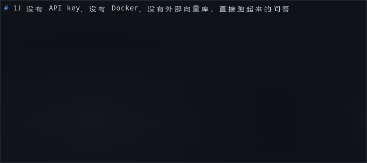

# SkillForge

> **Execution-time trust boundaries for AI agents — 什么不许答、什么必须批.**
> We sit alongside WeKnora (查得准) and Semantica (为什么) — three complementary
> lanes in the open-source AI agent stack.

**What is a Skill here?** A `SKILL.md` file in SkillForge is a *domain
adaptation contract* (knowledge tier boundaries + write targets +
refusal guardrails + system prompt). It is **not** a sandboxed skill
plugin (the WeKnora usage) and not an MCP tool (the Anthropic Agent
Skills usage). One `SKILL.md` retargets the same agent kernel to
legal review, HR policy, IT helpdesk, or any other business domain
— no recompilation, no code changes. Seven ready-to-run templates
ship in [`examples/skills/`](examples/skills/) — `simple-qa`,
`calculator`, `compliance`, `compliance-orchestrator`, `external-lookup`,
`kpi-dashboard`, and `monthly-report` — and
[`CONTRIBUTING.md`](CONTRIBUTING.md) walks you through writing your own.



[](https://go.dev/)
[](LICENSE)
[](.github/workflows/ci.yml)
📄 [Architecture](docs/architecture.md) · [Security policy](SECURITY.md) · [Code of Conduct](CODE_OF_CONDUCT.md) · [Contributing](CONTRIBUTING.md)

---

## Quick Start

Get a document-grounded, cited answer running in your browser in under 10 minutes.

### Prerequisites

| Dependency | Why | Minimum |
|------------|-----|---------|
| **Docker** (with Compose v2) | Runs the full stack (Milvus + backend + frontend) | Docker Desktop or Docker Engine |
| **Ollama** (or any OpenAI-compatible embedding endpoint) | Serves the BGE-M3 embedding model | `ollama pull bge-m3` |
| **GLM API key** (Zhipu Coding Plan) | Powers the LLM + the trust evaluator judge | [open.bigmodel.cn](https://open.bigmodel.cn/) |
| **~8 GB RAM** | Milvus standalone + Go backend + nginx | Milvus alone uses ~4 GB |

### Steps

```bash
# 1. Clone
git clone https://github.com/ninedrunk/skillforge.git
cd skillforge

# 2. Configure environment
cp .env.example .env
# Edit .env and fill in:
#   GLM_API_KEY=<your Zhipu key>
#   BGE_M3_URL=http://localhost:11434/v1/embeddings   (default; ollama)

# 3. Start the embedding endpoint (local minimum)
ollama pull bge-m3

# 4. The repo already ships the minimal QA Skill as the live default
#    (skills/simple-qa) — nothing to do. To swap the demo domain, drop
#    any examples/skills/ template into skills/ and remove the old one,
#    e.g. the cited-verdict compliance demo:
#      cp -r examples/skills/compliance skills/ && rm -r skills/simple-qa
#    Restart (or let hot-reload pick it up) for the change to take effect.

# 5. Bring up the full stack (Milvus + backend + frontend)
docker compose up

# 6. Open the app
#    Browser: http://localhost:8080
```

### Try it

Open **http://localhost:8080**, pick the **simple-qa** Skill, and ask a question about the loaded documents, e.g.:

> 差旅住宿费的报销标准是什么？

You should see either a **cited answer** (with clickable chunk references) or a **structured refusal** (e.g. `no_relevant_source`) — never a fabricated answer.

That is the platform in action: one kernel, one Markdown Skill file. Swap in a different template — the `calculator` or `compliance` Skill from `examples/skills/` — and the same kernel runs a different behavior, with a different knowledge boundary and a different set of guardrails.

The backend is also directly reachable at `http://localhost:8888` for `curl` probes, and Milvus gRPC is at `localhost:19530`.

### No API key? Stub LLM mode

SkillForge boots **without any LLM API key**. When neither `LOCAL_API_KEY` nor `GLM_API_KEY` is set, the server starts in **stub LLM mode**: the pipeline's answer model is replaced by a deterministic extractor (`internal/server/stubchat`) that assembles each answer from the verbatim text of the top retrieved chunk — no LLM is called, and the retrieval / grounding / refusal machinery is the real production code.

Three annotations make a stub answer impossible to mistake for a real one (D-08):

1. **`[WARN]` at boot** — the server logs `STUB LLM MODE — no LOCAL_API_KEY / GLM_API_KEY configured` at startup, before any request is served.
2. **`mode: "stub"` on the wire** — every stub verdict carries `mode: "stub"` in its JSON payload; real-model answers never emit the field, so the wire format stays backward-compatible. The UI renders a `STUB` badge on such cards.
3. **Conservative verdicts** — stub answers are always capped at `confidence ≤ 0.5` with `review_required: true`.

Observable consequences: answers are always verbatim quotes from a cited chunk (never paraphrased), refusals are more frequent (the stub refuses instead of guessing when no usable chunk text is found), and every response shows the `STUB` badge plus the 人工复核 flag. Note that `BGE_M3_URL` (the embedding endpoint) is still **required** in stub mode — stubbed is the LLM, not the retriever. Setting `GLM_API_KEY` (or `LOCAL_API_KEY` for an OpenAI-compatible local endpoint) and restarting switches back to the real model.

## Run without Docker / without an API key

The full stack above is the recommended path. This section is the **hermetic** path: no Docker, no Milvus, no etcd, no minio, and no LLM API key — just a Go toolchain, Node, and one embedding endpoint.

> **What `embedded` means.** `RETRIEVER_BACKEND=embedded` keeps the **vector store inside the backend process** (an in-process Go slice with cosine ranking). It does **not** mean the embedding model runs in-process: vectorization is always delegated to an external embedding endpoint, and there is **no fallback** — if that endpoint is unreachable the backend fails loudly instead of silently degrading to meaningless vectors.

### Prerequisites

| Dependency | Why | Minimum |
|------------|-----|---------|
| **Go** | Runs the backend | 1.23+ (CGO toolchain required — see `make check-cgo`) |
| **Node.js** | Runs the frontend dev server | 20+ (npm) |
| **One embedding endpoint** | Serves the embedding model — still required | see below |

### The embedding endpoint (still required — two interchangeable forms)

| Form | How | `BGE_M3_URL` |
|------|-----|--------------|
| **Local Ollama** (primary) | `ollama pull bge-m3` | `http://localhost:11434/v1/embeddings` |
| **Any OpenAI-compatible `/v1/embeddings` endpoint** | e.g. a hosted or self-hosted service | point `BGE_M3_URL` at its `/v1/embeddings` URL |

Both forms speak the same OpenAI-compatible wire format, so switching between them is a one-line `BGE_M3_URL` change. The local Ollama path needs no key and is the default in `.env.example`.

### Steps

```bash
# 1. Clone
git clone https://github.com/ninedrunk/skillforge.git
cd skillforge

# 2. Start the embedding endpoint (local minimum)
ollama pull bge-m3

# 3. Point the backend at the in-process vector store.
#    BGE_M3_URL is the embedding endpoint; SKILLFORGE_MCP_SERVICE_SKILL names
#    the Skill that answers questions.
export BGE_M3_URL=http://localhost:11434/v1/embeddings
export RETRIEVER_BACKEND=embedded
export SKILLFORGE_MCP_SERVICE_SKILL=simple-qa

# 4. Start the backend (listens on :8888)
go run ./cmd/server

# 5. In a second terminal, start the frontend (dev server on :5173,
#    proxying /api to :8888)
cd web && npm install && npm run dev

#    …or build the frontend once and let the backend serve it same-origin:
#    cd web && npm run build && cd .. && go run ./cmd/server
#    → http://localhost:8888

# 6. Open the app and ask a question, e.g.
#    差旅住宿费的报销标准是什么？
```

No `GLM_API_KEY` and no `LOCAL_API_KEY` were set, so the server boots in **stub LLM mode** and answers from the retrieved chunk text. Every such answer is labelled three ways: the wire payload carries `"mode":"stub"`, the boot log prints `STUB LLM MODE`, and the UI renders a `STUB` badge. The answer is still a real cited answer — retrieval, tier isolation, grounding and refusal are the production code paths; only the answer *writer* is deterministic.

Set `GLM_API_KEY` (or `LOCAL_API_KEY` for an OpenAI-compatible local endpoint) and restart to switch to the real model — the `mode` field then disappears entirely (it is omitted, not set to `"real"`).

Verify the whole hermetic path with the Phase 49 acceptance gate:

```bash
make verify-phase-49
```

### Bring your own chat model: the LLM provider panel (Phase 52)

The chat model does not have to be Zhipu. Any OpenAI-compatible
`chat/completions` endpoint works — including [OpenCode](https://opencode.ai)'s
paid **Go** / **Go Plus** plans and the pay-as-you-go **Zen** plan, whose
inference gateway speaks the OpenAI wire format. Three env vars are enough:

```bash
export LOCAL_API_KEY=<your provider key>
export LOCAL_BASE_URL=https://opencode.ai/inference/openai/v1/chat/completions
export LOCAL_MODEL=glm-5.3-flash        # or glm-5.3-flash-free, deepseek-v4.1-flash, …
```

Or skip the env vars entirely: **Admin UI → 模型配置** (`/api/admin/llm/*`,
X-Admin-Token gated) lists the built-in vendor → plan catalog (Zhipu Coding
Plan, OpenCode Go / Go Plus / Zen, OpenAI, DeepSeek, Moonshot, SiliconFlow,
Ollama, custom), lets you pick a plan (the base URL auto-fills), paste a key,
test the connectivity, pull the model list, and save — the change takes
effect on the next request, no restart.

**Where keys live.** The panel stores its config in a user-local JSON file
(default `~/.skillforge/llm.json`, mode 0600; override the path with
`SKILLFORGE_LLM_CONFIG`), and the GET endpoint always returns the key masked.
A key can also be referenced indirectly via an env-var name (`api_key_env`),
in which case only the variable name is persisted. opencode's own `/connect`
credentials stay in opencode's user-level auth store — SkillForge never reads
or writes them. Panel config takes precedence over the env preset above; a
failed runtime swap empties the active slot and the backend falls back to
stub mode (the startup `FAIL` still applies to a broken env preset only).

Verify the panel wiring with the Phase 52 acceptance gate:

```bash
make verify-phase-52
```

---

## Architecture

`docker compose up` brings up five services plus two external endpoints. The three moats — **approve-and-remember**, the **trust-contract kernel**, and the **CI-integrated trust gate** — are labeled below (the same three mechanisms detailed in [Why SkillForge? — The Three Moats](#why-skillforge--the-three-moats)).

```mermaid
flowchart TD
    subgraph compose["docker compose up (5 services)"]
        etcd["etcd<br/>(metadata)"]
        minio["minio<br/>(object storage)"]
        milvus["Milvus v2.4.x<br/>(vector DB, RocksMQ)"]
        backend["Go backend<br/>(Hertz :8888)<br/>─── trust-contract kernel ───<br/>pluggable SKILL.md under the moats<br/>no code changes"]
        frontend["nginx frontend<br/>(:8080 → :80)"]
    end

    etcd --> milvus
    minio --> milvus
    milvus -->|"trust-contract kernel primitive: tier-filter<br/>PRE-similarity metadata filter<br/>(part of Moat 2)"| backend
    backend -->|"/api proxy_pass<br/>SSE UIMessageChunk stream"| frontend
    frontend --> browser["🌍 Browser<br/>localhost:8080<br/>cited verdict / refusal card"]

    ollama["External: BGE-M3<br/>(ollama, embedding)"] -.->|"BGE_M3_URL"| backend
    glm["External: GLM API<br/>(Zhipu, LLM + judge)"] -.->|"GLM_API_KEY"| backend
    backend -.->|"frozen-replay eval engine<br/>Ragas 口径<br/>(feeds Moat 3: the CI-integrated trust gate)"| glm

    classDef moat fill:#fff3cd,stroke:#856404,stroke-width:2px;
    class backend glm milvus moat;
```

**The demo Skill is replaceable, not the product.** The tier-filter is a trust-contract-kernel primitive, the Skill registry is the contract format those moats are written in, and the eval engine exists to feed the CI-integrated trust gate — all three are domain-agnostic. All of the demo behavior — the retrieval boundary, the answer format, the refusal guardrails — lives in a single 30-line Markdown file ([`skills/simple-qa/SKILL.md`](skills/simple-qa/SKILL.md)). Delete it and SkillForge has no domain-specific logic left to remove.

---

## Why SkillForge? — The Three Moats

These three already-validated mechanisms are the defensible core of v1.1. Each is proven by a spike or phase success criterion; each is **not yet offered by the two mature competitors** in our lane (see comparison below).

> Canonical names, used identically everywhere in this document: **approve-and-remember** (Moat 1) · **trust-contract kernel** (Moat 2) · **CI-integrated trust gate** (Moat 3).

### 1. Approve-and-Remember as a first-class primitive

HITL write actions (Phase 11) bind operator approval to **byte-identical tool-call args** (`frozen_args` SHA-256) scoped to `(session, skill)`. A rejected argument cannot silently drift into an approved one (D11-C4 byte-identity invariant). Approved actions become **remembered rules** (`approval_rules` table) — the same `(target, args_hash, skill_id, scope_session_id)` PK, written by `INSERT … SELECT` in one tx with the audit row (`action_rule_created`). Revocation is `DELETE + action_rule_revoked` in another tx — T-3-AUDIT INSERT-only ledger, never an UPDATE.

| Pattern | SkillForge | Semantica | WeKnora |
|---------|-----------|-----------|---------|
| Pre-execution approval | ✅ `tool_call_id == approval_id` (D11-C4) | ❌ decision intelligence is post-hoc causal trace | ❌ no approval gate |
| Byte-identity binding | ✅ `frozen_args` SHA-256 | ❌ n/a (no gate) | ❌ n/a |
| Approve-and-remember rule | ✅ `(target, args_hash, skill_id, scope_session_id)` PK | ❌ n/a | ❌ n/a |
| Revocation is audit | ✅ `DELETE + action_rule_revoked` one tx | ❌ n/a | ❌ n/a |

Validated by `internal/approval_api_test.go` (D11-D3 / D11-D4 / D11-C4).

### 2. Trust Contract Kernel — refuse-by-construction

The agent kernel enforces four trust primitives **before any LLM call**, not by prompt pleading:

1. **Tier-filter at the database query** — `tier IN [...]` is a Milvus metadata filter; an authority-only Skill physically cannot see draft / personal notes.
2. **Refuse-by-construction** — when no chunk matches the declared `reads` filter, the answer is `no_authorized_source` *before* the verdict prompt. The agent never sees an ungrounded question.
3. **Citation whitelist = this retrieval round** — every answer carries the chunks that justified it. Adding chunks after the fact is impossible (the verifier checks the exact set).
4. **Default-deny on missing fields** — `internal/skill.Validate` rejects Skills with empty `reads`/`writes`/`steps` at load time. The trust boundary is the schema, not the operator's discipline.

This is why the trust floor matters in production: WeKnora's hybrid search gets more relevant chunks per query, but a WeKnora Skill without the SkillForge-style `reads` field can still hallucinate against the user's private notes. SkillForge physically cannot.

### 3. CI-Integrated Trust Gate (Skill 晋级闭环)

Every Skill promotion runs through `.github/workflows/eval-gate.yml`: frozen compliance replay (50 cases) → `cmd/eval --gate-check` against per-Skill thresholds (`examples/skills/<skill>/eval-gate.json`) → fail-closed exit code. Headline: faithfulness ≥ 0.9 / refusal-accuracy ≥ 0.95 — the gate that catches a Skill regression **before** it ships. Cross-judge + planned human-judge calibration (Phase 22-02) close the self-eval bias loop.

**评测器定位声明（Phase 22）**

The 4 metrics are a verbatim port of Ragas v0.1.21 (Apache-2.0, attributed in `eval/NOTICE`). SkillForge does **not** ship an independent evaluation platform — `internal/eval` is the **internal infrastructure** that backs the Skill promotion gate, and nothing more. If you want a standalone RAG evaluation suite, use [Ragas](https://docs.ragas.io/) directly (or DeepEval / TruLens); we deliberately do not compete in that lane.

| Aspect | Ragas / DeepEval / TruLens | SkillForge `internal/eval` |
|--------|---------------------------|----------------------------|
| Goal | Standalone RAG evaluation platform | Skill promotion gate inside the platform |
| Metrics | 4+ proprietary | 4 verbatim-port (Ragas v0.1.21) |
| Calibration set | User-supplied | 50-case frozen compliance golden (`.planning/phases/22-eval-ci/`) |
| Pin / lock | Optional | **Required** (`AssertPin` + frozen replay) |
| CI integration | User wires their own | First-class (`.github/workflows/eval-gate.yml`) |
| Cross-judge | Via LLM swap | `--judge-models glm-5.2,deepseek` + planned human-judge calibration (Phase 22-02) |
| License | Ragas Apache-2.0 / DeepEval Apache-2.0 / TruLens MIT | In-tree, no sidecar |

**Single-language posture**: keeping the evaluator in Go (no Python sidecar, no Ragas pip install) is a deployment convenience, not a competitive moat. We document this transparently because the value is the **CI integration + Skill promotion loop**, not the metric implementation.

---

## External Authorized Channel

Moat 1 (**approve-and-remember**) applied to the data warehouse. When a user asks for individual-level records — an employee's consumption last month, a customer's account number — SkillForge does not hand the agent a database connection. It asks a human first, every time:

1. user query → the Skill declares `reads: [data:external:authorized]`, so the agent sees the `needs_external_query` tool
2. the tool asks `nl2sql` for a **read-only SQL preview** over a registered view (the agent never authors SQL itself)
3. the request enters the **pending** state — a data officer approves or rejects it (no auto-reject, no auto-timeout)
4. on approval a **5-minute TTL token** is minted, scoped to `(view, session)`
5. the agent re-invokes with the `query_id` and receives **masked rows** — account numbers keep only the last 4 digits, phones the last 4, emails the first 2 local characters
6. both sides audit the event (internal ledger + warehouse-side log) and `reconcile` surfaces any one-sided row as a security event

| | |
|---|---|
| ✅ | Precompiled views only (registered from controlled `external_views/*.yaml` files at boot) · field-level masking on every returned row · approval is continuously pending until a human acts · dual-audit reconcile · the pending/approve/reject/execute/reconcile surfaces are `X-Admin-Token` gated |
| ⚠️ | `MemorySource` is the v1.1 reference warehouse driver (real Postgres/MySQL drivers land in v1.2 behind the same `Source` interface) · views come from controlled files in `external_views/` (a malformed file refuses to boot the channel) · the FE approval panel is not built — the HTTP surfaces + the agent tool are the interface · **`POST /api/external-auth/request` is intentionally agent-facing and un-gated in v1.1.1**: it can only create a pending request against an allowlisted view and writes an audit row; abuse is operator-visible as dual-audit rows via reconcile, and a shared secret + rate limit are queued for v1.2 (threat register T-W62-06) |
| ❌ | Never raw-table access · never auto-execute without an approved, unexpired token · never auto-reject or auto-timeout a pending approval · never return unmasked rows |

The channel is **off by default**. It runs only when the server is started with `EXTERNAL_AUTH_ENABLED=1` (plus `SKILLFORGE_EXTERNAL_VIEWS_DIR`, default `external_views/`); with the gate unset every `/api/external-auth/*` route answers `503` and no Skill can reach the tool.

---

## SkillForge vs WeKnora vs Semantica — three lanes, not three head-to-head rivals

| | SkillForge | WeKnora (Tencent) | Semantica (semantica-agi) |
|---|---|---|---|
| **Lane** | 什么不许答 / 什么必须批 — execution-time trust boundaries | 文档怎么查得准 — retrieval + multi-tenant RBAC | 决策为什么 — knowledge fact provenance + causal graph |
| **Differentiator** | approve-and-remember primitive + tier-filter at DB + refusal-by-construction + CI-integrated trust gate | hybrid retrieval quality (RAG + Wiki Mode), Go single-binary deployment, 4-level RBAC | W3C PROV-O standard for fact / decision tracing + time-travel replay |
| **Agent audit** | INSERT-only execution ledger (Phase 11 + 24); PROV-O export (Phase 24-01) | workspace audit log + AES-256-GCM at rest | PROV-O source of truth (their first-class citizen) |
| **Write actions** | HITL approval gate with frozen-args byte-identity + remember rule | ❌ no approval gate | ❌ decision intelligence is post-hoc, not pre-execution |
| **Eval posture** | In-tree Go gate (Ragas v0.1.21 verbatim port) | external benchmark suites | external |
| **License** | Apache-2.0 | MIT | MIT |
| **"Skill" means** | domain adaptation contract (one file = new domain) | sandboxed skill plugin (Docker / E2B / Cube) | n/a |

We are **complementary, not competing**:

- If you want **better document recall** → use WeKnora.
- If you want **why-the-agent-decided-X explanations** → use Semantica.
- If you want **an agent that physically cannot leak private data, cannot run unapproved writes, and cannot ship a regressed Skill** → use SkillForge.

**Support, not head-to-head.** SkillForge ships **PROV-O export** (`GET /api/session/:id/audit/prov`, Phase 24-01) so Semantica users can import SkillForge's execution audit as PROV-O entities. We view audit / decision-trace as a **supporting capability**, not a headline; Semantica is the leader there and we acknowledge it.

---

---

## Skills

Skills are declarative Markdown + YAML frontmatter files. Each defines a 7-field manifest (`description` / `agent` / `reads` / `writes` / `steps` / `guardrails` / `temperature`) that the kernel loads, validates, and routes against.

- **Templates:** [`examples/skills/`](examples/skills/) ships seven ready-to-run Skills — `simple-qa` (minimal authority-tier QA), `calculator` (tool-calling), `compliance` (cited verdicts + structured refusals), `compliance-orchestrator` (multi-agent compliance pipeline), `external-lookup` (guarded web fetch), `kpi-dashboard` (aggregated-only metrics), `monthly-report`, and `sql-guides` (data-tier Q&A). Each passes the schema validator out of the box.
- **Loaded Skills:** the kernel loads whatever is under [`skills/`](skills/) — the repo default is [`skills/simple-qa/SKILL.md`](skills/simple-qa/SKILL.md); drop any template there (and restart or let hot-reload pick it up) to make it the live domain.

See [`CONTRIBUTING.md`](CONTRIBUTING.md) for how to write your own Skill — the format is 7 fields of YAML frontmatter plus Markdown steps.

---

## Knowledge Bases

Knowledge lives in **knowledge bases (KBs)** managed by the runtime registry (Phase 26) — not a compile-time enum. Every KB carries exactly one of four **semantic roles**, and the role decides trust, not just filtering:

| Role | Meaning | Retrieval | Citable |
|------|---------|-----------|---------|
| `authority` | The **唯一可引用证据源 — the only citable evidence source**. The citation whitelist accepts authority-role chunks and nothing else; the whitelist is code-enforced at the single constant [`internal/kb.CitableRole`](internal/kb/kb.go). | default-on | **yes — the only citable role** |
| `historical` | Superseded revisions kept for the record. Not in default retrieval; reachable only through an explicit `reads` declaration (or an explicit point-in-time query). | explicit `reads` only | no — annotation channel |
| `personal` | User-private material. Excluded from retrieval unless a Skill explicitly declares it. | explicit `reads` only | no — annotation channel |
| `draft` | Not-yet-effective material, visible only as an ingestion preview. | **never** — the role outranks the KB's own retrieval switch | no |

Roles are platform constants (`Roles()` in [`internal/kb/kb.go`](internal/kb/kb.go) — the code-level canonical statement of these semantics); slugs, display names, descriptions, and the retrieval switches are registry data. Non-authority hits still reach the model through the counter-evidence annotation channel — they can inform an answer, but they can never back a citation.

### Adding a knowledge base

Adding a KB is a registry operation, not a code change:

1. **Register the base** — either a PR to the controlled seed file [`knowledge_bases.yaml`](knowledge_bases.yaml), or a runtime `POST /api/admin/kb` with the `X-Admin-Token` header (both audited, INSERT-only; no delete verb exists — deactivation hides a base, it never destroys data).
2. **Create the content directory** — `knowledge/<slug>/`, named after the slug.
3. **Restart** (or run the upload pipeline) — the startup indexer walks the registered directories and indexes every Markdown file under `tier = <slug>`.

An unregistered directory is skipped with a WARN and an audit row. See ["Add a Knowledge Base"](CONTRIBUTING.md#add-a-knowledge-base) for the full walkthrough.

KB directories may freely contain subdirectories for visual / git organization — the indexer walks recursively (Phase 999.2). Subdirectory paths are preserved in chunk `source` and the graph display, but Milvus retrieval is by tier slug (not by path). Use subdirectories to manage large corpora; use a new KB slug to encode semantic separation. See [CONTRIBUTING.md](CONTRIBUTING.md#organize-a-kb-with-subdirectories-phase-9992).

---

## Document Upload (Phase 27)

Admins can upload documents to any active knowledge base via `/admin` → 上传文档 panel:

- **Formats:** `.md` / `.pdf` / `.docx` / `.xlsx` / `.pptx` (Content-Type allowlist; magic-byte verification at upload time)
- **Size:** default 100 MB; override with `SKILLFORGE_UPLOAD_MAX_BYTES`
- **Flow:** multipart streaming → in-memory parse → chunk → embed → Insert → INSERT-only audit row
- **Trust:** no temp file ever; SHA-256 in memory; D-09 / KNOW-02 / citation whitelist unchanged
- **Live acceptance runbook:** see `.planning/phases/27-document-upload-pipeline/27-UAT.md` (Phase 27 Plan 06 T3)
- **Structural gate:** `bash scripts/verify-phase-27.sh` or `make phase-27`

---

## Knowledge Graph (Phase 28)

The knowledge graph (`GET /api/knowledge/graph`) reflects the registered knowledge bases and their document structure. Key capabilities:

- **N-dynamic nodes**: One node per active knowledge base (from KBRegistry), not a fixed 4-tier assumption
- **Deterministic relation edges**: Chunk relationships derived without LLM:
  - `section_adjacent`: consecutive chunk IDs within the same document
  - `version_chain`: EffectiveFrom/To windows showing policy supersession
  - `keyword_cooccur`: cross-document filename token Jaccard ≥ 0.3
  - `citation_cooccur`: chunks co-cited in the same verdict (from audit rows)
- **Neighbor API**: `GET /api/knowledge/graph/neighbors?chunk_id=X&depth=N` — explore relations
- **Path API**: `GET /api/knowledge/graph/path?from=X&to=Y&max_hops=N` — find relationships
- **Config-driven limits**: SKILLFORGE_GRAPH_MAX_NODES, MAX_EDGES, NEIGHBOR_DEPTH_LIMIT, PATH_HOPS_LIMIT

See [Phase 28 docs](./.planning/phases/28-dynamic-knowledge-graph/) for full runbook.

---

## Eval Results

This snapshot is the **frozen v0.8 compliance baseline** (Phase 8 pin — `eval/frozen/compliance.lock.json`, sha256 `5cf700f3…`). Every figure below is rendered verbatim by `go run ./scripts/eval_snapshot` from `eval/report.json` + the lock; none are hand-typed. Regenerating the lock is tampering (T-8-12) — it pins the model, prompt hash, and seed so the run is byte-identically reproducible.

Frozen run on **2026-08-21** · `eval_set_version: compliance-2026-08-13-v1` · `model_ver: glm-5.2` · `prompt_hash: 58ffea08…`

| Skill | Faithfulness | Context Precision | Refusal Accuracy | Cases |
|-------|-------------|-------------------|------------------|-------|
| compliance | 97% | 10% | 95% (19/20) | 50 (20 adversarial / 20 refusal-required / 10 multi-hop) |

**Reproduce:** `go run ./cmd/eval --frozen=compliance`

The frozen lock (`eval/frozen/compliance.lock.json`) pins the model, prompt hash, and seed for byte-identical reproducibility (SC-6).

---

## Contributing

Contributions are welcome — especially **new Skills** that prove the platform thesis. SkillForge is designed so that the highest-leverage contribution is a domain `SKILL.md`, not Go code.

## Community & Security

- 🛡️ [SECURITY.md](SECURITY.md) — how to report a vulnerability privately, and how the project thinks about security
- 🤝 [CODE_OF_CONDUCT.md](CODE_OF_CONDUCT.md) — Contributor Covenant v2.1
- 📋 Issue & PR templates — `.github/ISSUE_TEMPLATE/` and `.github/PULL_REQUEST_TEMPLATE.md` (bug reports ask you to redact keys; PRs carry the verification checklist)
- 🏗️ [docs/architecture.md](docs/architecture.md) — the four-layer component map with code entry points

See **[CONTRIBUTING.md](CONTRIBUTING.md)** for guides on:
- Writing a Skill (the 7-field schema + validation)
- Adding a tool (the Eino `tool.InvokableTool` interface)
- Adding a knowledge base (the registry + `knowledge/<slug>/` convention)

The standard flow is fork → branch → PR. Run `gofmt` and `go test ./...` before opening a PR.

---

## License

**Apache-2.0** — see [LICENSE](LICENSE).

The faithfulness evaluator ports Ragas v0.1.21 prompts (Apache-2.0); attribution is in [`eval/NOTICE`](eval/NOTICE).
