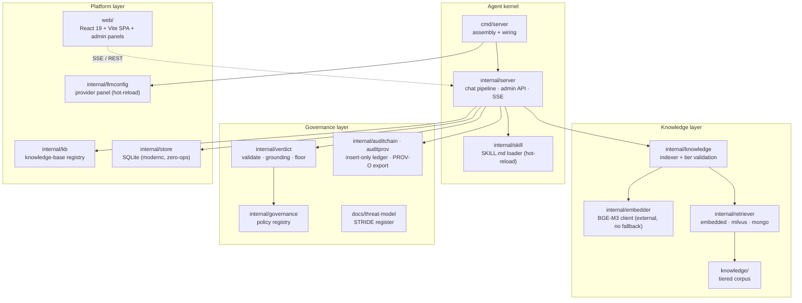

# Architecture

One paragraph before the diagram: SkillForge is an **execution-time trust boundary** for AI agents. A single agent kernel is retargeted per business domain by a `SKILL.md` contract; every answer is retrieved from tier-isolated knowledge, grounded against its cited chunks, and — for any write action — gated by a human approval primitive. The kernel refuses by construction; it does not guess.

## The four layers

### 1. Agent kernel

One kernel, many domains. `cmd/server` wires the dependencies; `internal/server` runs the chat pipeline (retrieve → ground → verdict → SSE); `internal/skill` loads `SKILL.md` contracts — each one a *domain adaptation contract* (knowledge tier boundaries, write targets, refusal guardrails), hot-reloaded without recompilation.

**Enter the code here:** `cmd/server/main.go` (assembly), `internal/server/pipeline.go` (the VerdictPipeline), `internal/skill/loader.go`.

### 2. Knowledge layer

Corpus on disk (`knowledge/` — authority / draft / historical / personal / sql-guides tiers), embedded by a **real external model** (`internal/embedder/bge` — the endpoint is required; there is deliberately no in-process fallback), stored either in-process (`internal/retriever/embedded`), in Milvus, or in Mongo. Tier filtering is a **two-stage pre-filter**: candidates are constrained by tier *before* any cosine scoring, so an unauthorized tier can never influence ranking.

**Enter the code here:** `internal/knowledge/indexer.go` (indexing + tier validation), `internal/retriever/embedded/` (local-vector mode), `internal/vecmath/cosine.go` (the single similarity implementation).

### 3. Governance layer

Every model verdict is parsed, validated (`internal/verdict/validate.go`), grounded against its cited chunk text (`internal/verdict/grounding.go` — a citation whose span does not appear in the chunk is downgraded), and floored (`internal/verdict/floor.go`). Write actions pass through a human approval gate with frozen-args byte-identity. The full execution ledger is insert-only and exports PROV-O. The threat model that drove these mechanisms lives in `docs/threat-model/`.

**Enter the code here:** `internal/verdict/grounding.go`, `internal/server/approval_api.go`, `internal/auditchain/chain.go`.

### 4. Platform layer

The persistence and product surface: the knowledge-base registry (`internal/kb`), zero-operations SQLite storage (`internal/store`), the React SPA plus admin panels (`web/`), and the LLM provider panel (`internal/llmconfig` + `internal/llm` — vendor catalog, hot-reload chat model, masked keys in a user-local file).

**Enter the code here:** `internal/kb/kb.go`, `internal/store/sqlite/`, `web/src/components/admin/`.

## Request lifecycle

1. `POST /api/chat` — the skill's trust contract resolves which knowledge tiers may be read.
2. The query is embedded by the external model and searched **within those tiers only** (pre-filter).
3. Zero hits ⇒ refuse (`no_authorized_source`); score below threshold ⇒ refuse (`low_retrieval_score`).
4. The LLM (or the deterministic stub, labelled `mode:"stub"` on the wire) drafts a verdict over the retrieved chunks.
5. The verdict is validated, grounded, and emitted over SSE with citations; write actions stop at the approval gate.

## Further reading

- [README](../README.md) — quick start, trust-boundary positioning, three moats
- [CONTRIBUTING.md](../CONTRIBUTING.md) — build, verify gates, how to add a Skill
- [docs/threat-model/](threat-model/) — STRIDE register behind the governance layer
- [SECURITY.md](../SECURITY.md) — reporting policy
